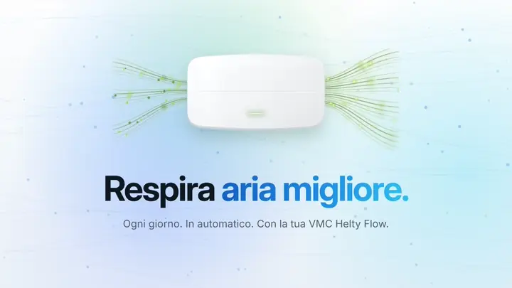
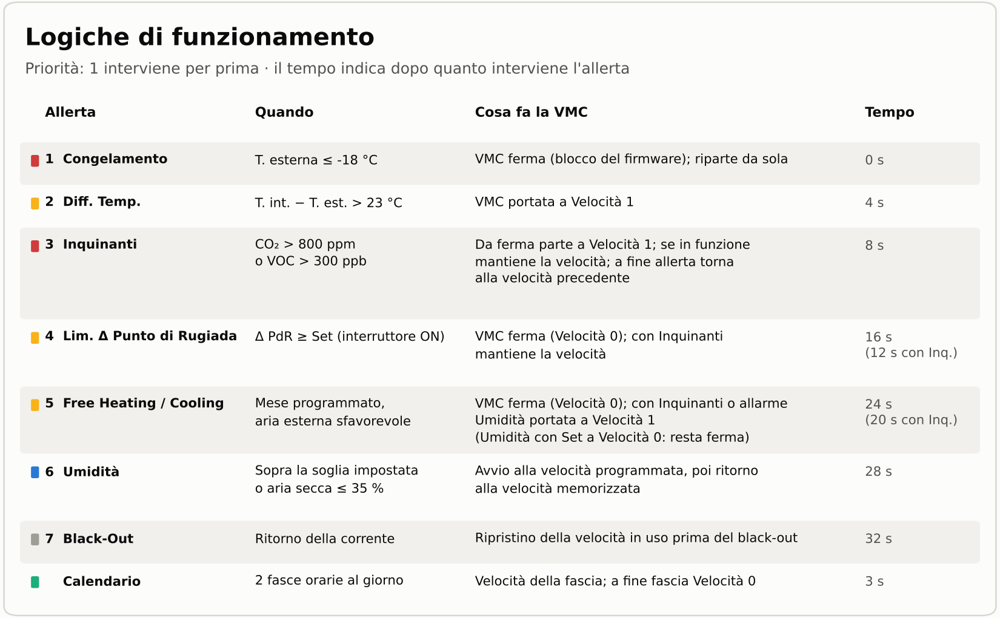
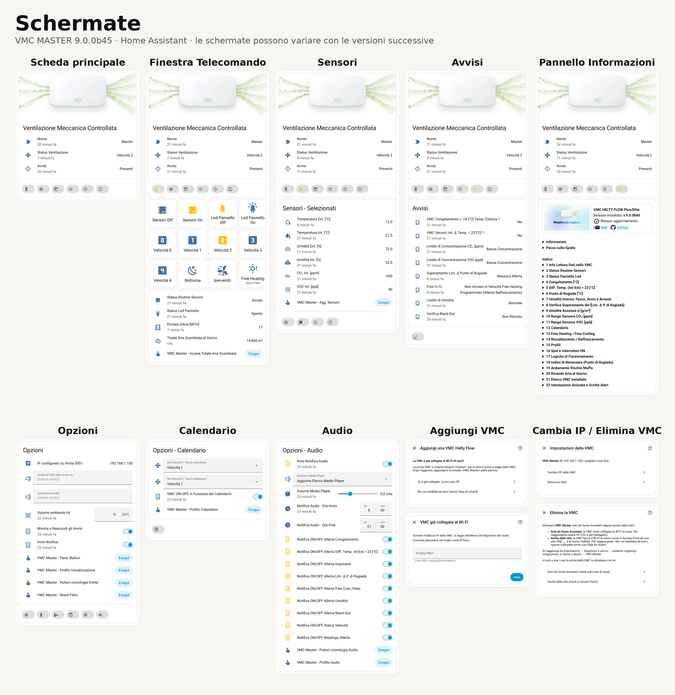
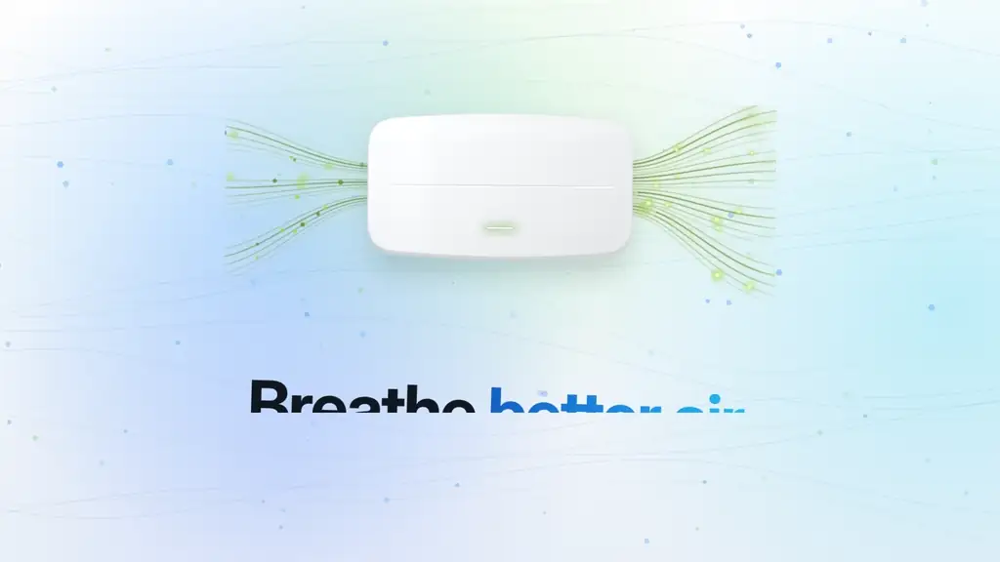
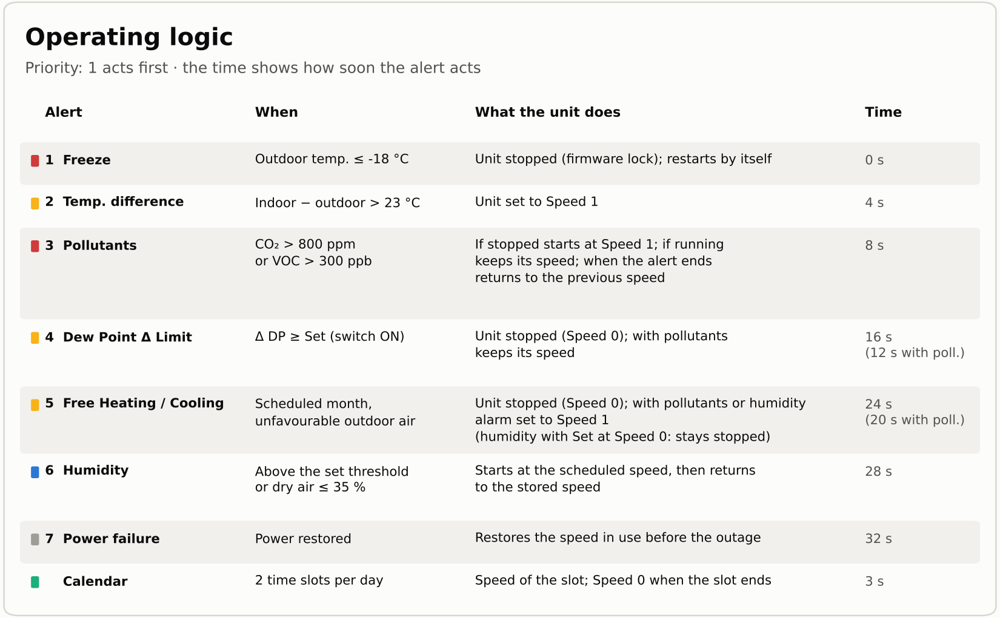
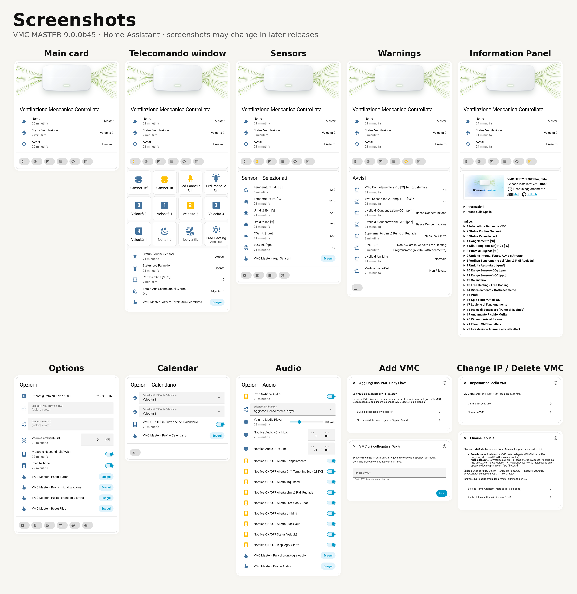

<p align="center">
  <a href="https://github.com/DanRobo76/VMC-HELTY-FLOW-MARKETPLACE/raw/main/Video/VMC_MASTER_promo_IT.mp4">
    
  </a>
  <br>
  <sub>Video di presentazione · 1 minuto e 17 secondi · clicca per scaricarlo</sub>
</p>

---

<p align="center">
  <strong>Scegli la lingua / Choose your language:</strong>
</p>

<details>
  <summary>🇮🇹 <strong>ITALIANO (Clicca per espandere)</strong></summary>

<h1 align="center">
  VMC MASTER
  <a href="https://www.home-assistant.io/" target="_blank">
    
  </a>
  <a href="https://www.heltyair.com/prodotti/vmc-a-parete/flow-plus/" target="_blank">
    
  </a>
</h1>

<p align="center">
  <strong>La tua ventilazione meccanica controllata in Home Assistant.</strong><br>
  Integrazione per VMC Helty Flow Plus / Elite: si installa dal Marketplace di Home Assistant e ogni VMC si aggiunge con il suo IP.
</p>

<p align="center">
  Hai già provato <strong><a href="https://github.com/DanRobo76/Aspiratore">ASPIRATORE MASTER</a></strong>?
</p>

---
<details>
<summary><strong>Perché VMC MASTER</strong></summary>

<sub>**VMC MASTER** è un'integrazione per Home Assistant progettata per la gestione delle VMC **Helty Flow Plus / Elite** (le stesse che si comandano con l'App Air Guard). L'App funziona solo con il telefono collegato al Wi-Fi di casa; con Home Assistant la VMC si comanda in casa e anche da fuori casa.</sub>
<br>
<sub>Non è un semplice telecomando, ma una logica evoluta che confronta in continuo le condizioni interne ed esterne (temperatura, umidità, punto di rugiada, inquinanti) e decide se e a quale velocità far funzionare la VMC, con priorità precise tra le allerte e la ripresa automatica della velocità impostata.</sub>
</details>

<details>
<summary><strong>Cosa lo rende diverso</strong></summary>

| <sub>Funzione</sub> | <sub>Vantaggio</sub> |
|---|---|
| <sub>**Installazione dal Marketplace**</sub> | <sub>Nessun file da copiare: basta aggiungere due righe a `configuration.yaml` (altre due per le Notifiche Audio); gli aggiornamenti arrivano dal Marketplace</sub> |
| <sub>**Logiche con priorità**</sub> | <sub>Congelamento, Δ temperatura, inquinanti, punto di rugiada, Free Cooling / Free Heating, umidità e black-out gestiti in un ordine preciso, con ripresa automatica</sub> |
| <sub>**Controllo del punto di rugiada**</sub> | <sub>La VMC si arresta quando porterebbe in casa umidità dall'esterno</sub> |
| <sub>**Free Cooling / Free Heating**</sub> | <sub>Nessun raffrescamento o riscaldamento indesiderato nei mesi programmati; aria calda o fresca gratuita quando conviene</sub> |
| <sub>**Qualità dell'aria**</sub> | <sub>Avvio e arresto in funzione di CO₂ e VOC (sensori della VMC Flow Elite; CO₂ anche da un'entità di Home Assistant)</sub> |
| <sub>**Controllo dell'umidità interna**</sub> | <sub>Avvio automatico alla velocità programmata, anche con aria secca (≤ 35%), e ritorno alla velocità memorizzata</sub> |
| <sub>**Calendario**</sub> | <sub>2 fasce orarie per ogni giorno della settimana e 2 fasce mensili</sub> |
| <sub>**Selezione dinamica delle entità**</sub> | <sub>Sensori di Home Assistant e servizi meteo al posto dei sensori della VMC, con offset</sub> |
| <sub>**Intestazione animata**</sub> | <sub>Il flusso d'aria scorre in funzione della portata e il colore del LED indica lo stato: bianco normale, giallo allerta (che respira a VMC ferma con Avvisi presenti), blu umidità, rosso inquinanti, grigio OFF-Line; le scritte «Alert», «Alert Δ Temp.» e «Alert Free» sotto i tasti avvisano, prima di avviare la VMC, che un'allerta la bloccherebbe o la ridurrebbe [Pannello Informazioni → voce 22]</sub> |
| <sub>**Avvisi e notifiche**</sub> | <sub>Su dispositivo mobile e tramite Media Player</sub> |
| <sub>**Più VMC**</sub> | <sub>Ogni VMC si aggiunge da *Dispositivi e servizi*: per una VMC già in rete basta l'IP</sub> |
| <sub>**Prima installazione**</sub> | <sub>Collegamento della VMC nuova al Wi-Fi di casa da *Aggiungi dispositivo*, senza l'App Air Guard, che poi resta comunque utilizzabile</sub> |
</details>

<details>
<summary><strong>Funzionalità complete</strong></summary>

- <sub>Indicatore Andamento Rischio Muffa.</sub>
- <sub>Indicatore che converte il punto di rugiada (TPdR) in una classificazione qualitativa del comfort igrometrico all'interno dell'ambiente.</sub>
- <sub>Visualizza in tempo reale: il numero totale di ricambi d'aria effettuati nella giornata, il volume totale di aria scambiata (m³) e il tempo rimanente prima del prossimo ricambio completo [Cliccare su Telecomando].</sub>
- <sub>Mostra in tempo reale il «Tempo Mancante» di ogni attesa dell'automazione (es. «Annullamento Memoria Free Heating», «Cambio Velocità per Lim. Δ PdR», «Ripristino dopo Black-Out») e la «Velocità Registrata» che verrà ripristinata a fine allerta, in un riquadro compatto sotto il pannello VMC.</sub>
- <sub>I tempi di attesa dei trigger dell'automazione sono fissi e non vanno modificati: non compaiono nella scheda e il Profilo Inizializzazione li riporta ai valori originali.</sub>
- <sub>L'automazione esegue gli eventi uno alla volta, nell'ordine in cui arrivano: nessun evento interrompe un comando già avviato (zero collisioni); un evento si esegue solo se la sua condizione è ancora vera quando arriva il suo turno; durante un Black-Out i cicli di conferma della velocità si fermano come prima e, se il Black-Out arriva mentre un'allerta sta finendo, al ripristino la VMC torna alla velocità di fine allerta; ogni ciclo di conferma si ferma se l'utente sceglie un'altra velocità.</sub>
- <sub>Mostra il tempo che manca alla prossima lettura della VMC da parte di Home Assistant e, sotto ogni voce, da quanto tempo è avvenuta l'ultima lettura: Ping, Sensori Ventilazione, Sensori Ambientali, Sensori Lan e Sensore Nome [Sensori - Selezionati → Timer Lettura Dati VMC].</sub>
- <sub>Nella finestra Telecomando il tasto della velocità attiva è illuminato e quello della velocità da ripristinare è illuminato con l'icona ↺. I tasti Sensori e Led Pannello illuminano lo stato attuale (On oppure Off); con «Verificare Filtro» il tasto «Led Pannello On» mostra l'icona del filtro.</sub>
- <sub>Elenca tutte le VMC installate in una tabella, una colonna per VMC [Pannello Informazioni → voce 21].</sub>
- <sub>Toccando un sensore delle schede «Sensori - Selezionati», «Sensori - Extra» e «Sensori VMC Interni» si apre il grafico della sua cronologia; quando il dato non è disponibile il grafico mostra un buco e non 0. Brevi picchi verso il valore della sonda della VMC a ogni avvio di Home Assistant e dopo un aggiornamento sono normali: l'entità scelta non è ancora pronta e per pochi secondi si usa la sonda della VMC [Pannello Informazioni → voce 15, Nota Entità Scelte non Disponibili].</sub>
- <sub>Avvisa l'utente tramite notifica sul Dispositivo Mobile in caso di Avvio, Arresto, Errori o cambio filtro della VMC.</sub>
- <sub>Permette lo spegnimento automatico in funzione della Temperatura Esterna ≤ -18 °C e successiva ripresa in funzione degli offset impostati.</sub>
  > <sub>**Nota:** per impostazione firmware, la priorità è assegnata al sensore interno della VMC rispetto al valore rilevato dal sensore esterno dell'entità selezionata.</sub>
- <sub>Permette l'avvio automatico a Velocità 1 in funzione della Differenza Temperatura Interna - Temperatura Esterna se > 23 °C e successiva ripresa.</sub>
  > <sub>**Nota:** per impostazione firmware, la priorità è assegnata ai sensori interni della VMC rispetto ai valori rilevati dal sensore esterno dell'entità selezionata.</sub>
- <sub>Ripristina la velocità in caso di Black-Out (se la VMC ha linea dedicata al quadro elettrico e/o è installato un relè domotico); durante una fascia del Calendario, al ritorno della corrente, la VMC riparte con la velocità della fascia in corso.</sub>
- <sub>Calcola il tempo di ricambio d'aria in funzione della velocità.</sub>
- <sub>Calcola la portata d'aria (m³/h) in funzione della velocità.</sub>
- <sub>Calcola l'umidità assoluta esterna e interna (g/m³).</sub>
- <sub>Pulisce la cronologia delle entità del Package mostrando prima, in un riquadro di conferma, il numero e l'elenco delle entità coinvolte e quante di esse sono registrate nel database (le entità escluse sono indicate in un unico elenco nella sezione «recorder» del package).</sub>
- <sub>Mostra avvisi in funzione di:</sub>
  - <sub>sensori CO₂ e/o VOC;</sub>
  - <sub>sensore umidità;</sub>
  - <sub>congelamento;</sub>
  - <sub>differenza tra temperatura interna ed esterna;</sub>
  - <sub>superamento del Set Lim. Δ Punto di Rugiada;</sub>
  - <sub>riscaldamento o raffrescamento indesiderato (Free Heating / Free Cooling).</sub>
- <sub>Mostra sulla scheda se c'è un aggiornamento disponibile, anche per le versioni beta. L'avviso arriva dalle release di GitHub, controllate all'avvio di Home Assistant, ogni 24 ore, con «Agg. Sensori» e all'apertura del pannello «Informazioni» (in questo caso al massimo una volta al minuto). Se GitHub non risponde, la scheda scrive «Controllo aggiornamenti non riuscito (nessuna connessione a GitHub)».</sub>
- <sub>Permette di selezionare la «Condizione Climatica Esterna» da introdurre tramite il «Set Lim. Δ Punto di Rugiada».</sub>

<br>

<sub>**Servizi da usare nelle proprie automazioni e script.** Ogni servizio invia un comando alla VMC. Qui la VMC si chiama `master`: per un'altra VMC sostituire `master` con il suo nome.</sub>

| <sub>Servizio</sub> | <sub>Cosa fa</sub> |
|---|---|
| <sub>`shell_command.vmc_master_velocita_0`</sub> | <sub>Ferma la VMC (Velocità 0)</sub> |
| <sub>`shell_command.vmc_master_velocita_1`</sub> | <sub>Velocità 1</sub> |
| <sub>`shell_command.vmc_master_velocita_2`</sub> | <sub>Velocità 2</sub> |
| <sub>`shell_command.vmc_master_velocita_3`</sub> | <sub>Velocità 3</sub> |
| <sub>`shell_command.vmc_master_velocita_4`</sub> | <sub>Velocità 4</sub> |
| <sub>`shell_command.vmc_master_notturna`</sub> | <sub>Velocità Notturna</sub> |
| <sub>`shell_command.vmc_master_iperventilazione`</sub> | <sub>Iperventilazione</sub> |
| <sub>`shell_command.vmc_master_freecooling`</sub> | <sub>Free Cooling / Free Heating</sub> |
| <sub>`shell_command.vmc_master_sensori_on`</sub> | <sub>Accende i sensori della VMC</sub> |
| <sub>`shell_command.vmc_master_sensori_off`</sub> | <sub>Spegne i sensori della VMC</sub> |
| <sub>`shell_command.vmc_master_pannello_led_on`</sub> | <sub>Accende i LED del pannello</sub> |
| <sub>`shell_command.vmc_master_pannello_led_off`</sub> | <sub>Spegne i LED del pannello</sub> |
| <sub>`shell_command.vmc_master_reset_filtro`</sub> | <sub>Azzera il contatore del filtro</sub> |

<sub>Esempio: ogni sera alle 22:00 la VMC passa alla Velocità 1.</sub>

```yaml
alias: VMC a Velocità 1 alle 22
triggers:
  - trigger: time
    at: "22:00:00"
actions:
  - action: shell_command.vmc_master_velocita_1
```

<sub>Per usarlo:</sub>
1. <sub>*Impostazioni → Automazioni e scenari → Crea automazione → Crea nuova automazione*;</sub>
2. <sub>menu **⋮** in alto a destra → **Modifica in YAML**;</sub>
3. <sub>incollare il testo;</sub>
4. <sub>premere **Salva**.</sub>
</details>

<details>
<summary><strong>Scenario tipico</strong></summary>

<sub>Un classico caso d'uso è un'abitazione con:</sub>
- <sub>VMC Helty Flow Plus o Flow Elite collegata alla rete di casa (con l'App Air Guard oppure da *Aggiungi dispositivo* dell'integrazione)</sub>
- <sub>Home Assistant 2026.11 o successivo</sub>
- <sub>sensori di temperatura e umidità, interni ed esterni, oppure un servizio meteo</sub>
- <sub>un dispositivo mobile per le notifiche</sub>

<sub>**Risultato:** la VMC ventila quando serve, si ferma quando l'aria esterna porterebbe umidità, freddo o caldo indesiderati e riparte da sola alla velocità impostata.</sub>
</details>

<details>
  <summary><strong>Requisiti</strong></summary>

- <sub>**[Home Assistant](https://www.home-assistant.io/installation/) 2026.11** o successivo, con il Marketplace integrato. La versione si legge in *Impostazioni → Informazioni*.</sub>
- <sub>VMC **Helty Flow Plus** oppure **Flow Elite**, quelle dell'App **[Air Guard](https://play.google.com/store/apps/details?id=com.helty.heltyair&hl=it&gl=US&pli=1)**</sub>
- <sub>Indirizzo IP della VMC statico (impostato nel router); la VMC risponde sulla porta 5001</sub>
- <sub>**Solo per collegare al Wi-Fi di casa una VMC nuova senza l'App Air Guard:** Home Assistant OS con il Supervisor, installato su un computer dotato di scheda Wi-Fi integrata oppure con una chiavetta USB Wi-Fi compatibile collegata; la scheda deve risultare tra le interfacce di rete di Home Assistant (Impostazioni → Sistema → Rete).</sub>
<br>

> <sub>⚠️ **ATTENZIONE!** Se la VMC utilizza un'app diversa da **Air Guard**, il codice molto probabilmente non sarà compatibile 🧰.</sub>
</details>

<details>
<summary><strong>Installazione</strong></summary>

1. **Modificare `configuration.yaml`** (una volta sola):
   - installare l'app **File editor**: *Impostazioni → Applicazioni → Installa app → File editor → Installa*;
   - premere **Avvia**, poi **Apri l'interfaccia web**;
   - premere l'icona della **cartella** in alto a sinistra e scegliere `configuration.yaml`;
   - aggiungere in fondo:

     ```yaml
     homeassistant:
       packages: !include_dir_named packages/
     ```

     Se la riga `homeassistant:` c'è già, aggiungere subito sotto solo la seconda riga, con due spazi davanti;
   - solo per le Notifiche Audio, aggiungere in fondo anche:

     ```yaml
     tts:
       - platform: google_translate
     ```

     Servono proprio queste righe: aggiungere Google Translate solo da *Impostazioni → Dispositivi e servizi* non basta e le Notifiche Audio resterebbero mute;
   - salvare con l'icona del **dischetto**.
2. **Aggiungere il repository**:
   - aprire *Impostazioni → Marketplace → ⋮ → Repository personalizzate*;
   - scrivere `https://github.com/DanRobo76/VMC-HELTY-FLOW-MARKETPLACE`;
   - scegliere il tipo **Integrazione** e premere **Aggiungi**;
   - chiudere la finestra.
3. **Installare**: cercare **VMC Master** nel Marketplace e premere **Installa**.
4. **Aggiungere la VMC**: *Impostazioni → Dispositivi e servizi → + Aggiungi integrazione → VMC Master*.
   - VMC nuova, mai collegata: vedere **VMC nuova** qui sotto.
   - VMC già collegata al Wi-Fi di casa:
     1. scegliere **«Sì, è già collegata: scrivo solo l'IP»**;
     2. scrivere l'IP: si legge nell'elenco dei dispositivi del router (l'App Air Guard non lo mostra);
     3. premere **Invia**;
     4. se la VMC è spenta compare «VMC non raggiungibile»: premere **Invia**, la VMC si aggiunge lo stesso;
     5. premere **Finito**.

     Suggerimento: usare lo stesso nome della VMC per conservare la cronologia.

     L'integrazione controlla:
     - che l'IP non sia già usato da un'altra VMC;
     - che a quell'IP la VMC risponda sulla porta 5001.
5. **Riavviare**:
   1. aprire *Impostazioni*;
   2. cliccare **«VMC Master: riavviare Home Assistant»**;
   3. premere **Invia**.
6. **Aggiungere la scheda**:
   - premere **Ctrl+F5**;
   - nella plancia (va bene anche **Panoramica**) premere **matita → Aggiungi scheda → Sfoglia tutte le schede**;
   - nel campo **Cerca schede** digitare `vmc`;
   - cliccare su **VMC Master**;
   - scegliere la VMC nel campo **VMC\***;
   - premere **Salva**, poi **Fatto**.
7. **Una volta per ogni VMC**, nel pannello **Opzioni** della scheda:
   - premere **Esegui** su **«VMC ‹nome› - Profilo Inizializzazione»**;
   - confermare con **OK** e attendere 10 s;
   - premere **Sensori Opzionati** (icona chip di memoria);
   - scegliere i sensori.

**Altre VMC**: *Impostazioni → Dispositivi e servizi → VMC Master → Aggiungi dispositivo*, poi come dal punto 4. Si possono aggiungere più VMC e riavviare una volta sola.

**VMC nuova** (senza l'App Air Guard, vedere *Requisiti*):
1. accendere la VMC: crea la rete `VMC_xxxxxxxx`;
2. al punto 4 dell'Installazione scegliere **«No, va installata da zero (senza l'App Air Guard)»**;
3. scegliere la rete `VMC_xxxxxxxx` (password `12345678`);
4. scegliere la **Rete Wi-Fi di casa**;
5. scrivere la **Password del Wi-Fi di casa**;
6. solo se il server di Home Assistant è collegato a una rete Wi-Fi diversa dalla «Rete Wi-Fi di casa», scrivere anche la **«Password del Wi-Fi attuale del server»**;
7. premere **Invia**;
8. attendere da 1 a 3 minuti;
9. se la finestra si chiude:
   1. ripetere il punto 4 dell'Installazione;
   2. scegliere **«Continua con la VMC appena collegata (VMC_xxxxxxxx, IP …)»**;
10. prenotare sul router un IP fisso per la VMC;
11. se l'IP prenotato è uguale a quello mostrato, premere **Invia**;
12. se è diverso:
    1. spegnere e riaccendere la VMC dal suo interruttore, perché prenda l'IP prenotato;
    2. scrivere l'IP prenotato;
    3. premere **Invia**;
13. premere **Invia** nelle finestre successive;
14. premere **Finito**;
15. continuare dal punto 5 dell'Installazione.

Al punto 12 qui sopra l'integrazione controlla:
- che l'IP non sia già usato da un'altra VMC;
- che a quell'IP risponda la stessa VMC.

Se il collegamento non riesce, la finestra mostra il motivo e permette di riprovare.

**Aggiornare**:
1. quando il Marketplace segnala una nuova versione, premere **Aggiorna**;
2. riavviare Home Assistant.

Per controllare subito se c'è una nuova versione: pagina di VMC Master **⋮ → Aggiorna le informazioni**.

I file del package non vanno modificati: un file modificato a mano viene ripristinato all'avvio (la copia resta in `/config/vmc_master_backup`).

Se subito dopo un riavvio di Home Assistant la scheda mostra «Custom element doesn't exist», ricaricare la pagina.

</details>

<details>
<summary><strong>Configurazione</strong></summary>

Dopo l'installazione tutto si regola dall'interfaccia, senza modificare lo YAML.

**Dalla scheda «VMC Master»:**
- indirizzo IP e nome della VMC («Cambia IP VMC (Riavvio di H.A.)» e «Cambia Nome VMC»);
- selezione delle entità: Temperatura (interna ed esterna), Umidità (interna ed esterna), CO₂ interna, Dispositivo Mobile e Media Player;
- offset dei sensori;
- `Set Lim. Δ Punto di Rugiada` e Condizione Climatica Esterna;
- calendario (2 fasce orarie per ogni giorno) e mesi di Free Heating / Free Cooling;
- interruttori ON/OFF di ogni funzione: inquinanti, punto di rugiada, Free Cooling, Free Heating, umidità, calendario;
- Notifiche Audio: Media Player, volume, orari e categorie di allerta.

Ogni script chiede conferma con il popup «Vuoi Procedere?». Per i dettagli aprire il **Pannello Informazioni** della scheda, con 22 voci illustrate.

**Da *Impostazioni → Dispositivi e servizi → VMC Master*:**
- **nome della VMC**: la riga mostra il nome dell'App Air Guard e si aggiorna a ogni avvio; con **tre puntini → Rinomina** se ne può mostrare un altro. Il nome interno (cartella, entità, scheda) non cambia;
- **cambiare l'IP** (in alternativa al campo della scheda):
  1. icona ingranaggio sulla riga della VMC → **«Cambia l'IP della VMC»**;
  2. scrivere il nuovo IP;
  3. premere **Invia**.

  L'integrazione controlla:
  - che l'IP non sia già usato da un'altra VMC;
  - che a quell'IP, sulla porta 5001, risponda una VMC e non un altro dispositivo;
  - che risponda la stessa VMC (stesso nome).

  Se risponde una VMC con un altro nome, oppure non risponde nessuno (per esempio la VMC è spenta), compare un avviso: un secondo **Invia** salva l'IP lo stesso;
- **eliminare una VMC**:
  1. icona ingranaggio → **«Elimina la VMC»**;
  2. scegliere una delle due voci:
     - **«Solo da Home Assistant (resta sulla rete di casa)»**: per riaggiungerla basta scrivere l'IP;
     - **«Anche dalla rete (torna in Access Point)»**: la VMC mostra di nuovo la sua rete VMC_…; per ricollegarla scegliere **«No, va installata da zero (senza l'App Air Guard)»**, oppure usare l'App Air Guard.

  In tutti e due i casi:
  - la cartella della VMC va in `/config/vmc_master_backup`;
  - le entità della VMC spariscono subito, poi riavviare Home Assistant;
  - togliere la sua scheda dalla plancia;
  - per riaggiungere la VMC: **Aggiungi dispositivo** (**Aggiungi integrazione** se non restano altre VMC).

  Anche **tre puntini → Elimina** funziona, ma elimina la VMC solo da Home Assistant.
</details>

<details>
<summary><strong>Logiche di funzionamento</strong></summary>

<sub>La tabella riassume priorità, comportamento della VMC e tempi di intervento di ogni allerta. Il dettaglio completo è nel Pannello Informazioni, voce 17.</sub>


</details>

<details>
<summary><strong>Schermate</strong></summary>

<sub>Le schermate possono variare in funzione dell'ultima versione rilasciata.</sub>


</details>

<details>
<summary><strong>Licenza</strong></summary>

<sub>**[GNU General Public License v3.0](https://github.com/DanRobo76/VMC-HELTY-FLOW-MARKETPLACE/blob/main/LICENSE)**. Copyright © 2023-2026 Ing. Danilo Robotti. È consentito usare, copiare, modificare e distribuire il software, anche per scopi commerciali; chi lo distribuisce, anche modificato, deve renderne disponibile il codice sorgente con la stessa licenza e mantenere la nota di copyright. Il software è fornito senza alcuna garanzia.</sub>

<sub>**Impiego dell'Intelligenza Artificiale:** nello sviluppo del software l'autore si è avvalso anche di strumenti di intelligenza artificiale.</sub>
</details>

<details>
<summary><strong>Esonero di responsabilità</strong></summary>

<sub>Il software è fornito «così com'è», senza garanzie di alcun tipo. In nessun caso lo sviluppatore sarà responsabile di danneggiamenti diretti, indiretti o conseguenti, correlati a difetti del presente software. L'utente ha l'onere e la responsabilità della scelta, dell'installazione, dell'uso e della gestione del software al fine del raggiungimento del risultato prefissatosi.</sub>
</details>

---
<p align="center">
  Se il progetto ti è stato utile, puoi
  <a href="https://www.paypal.com/ncp/payment/8LT4JJW7MHW6U">
    offrirmi un ginseng ☕ e supportarne lo sviluppo
  </a>.
  <br><br>
  Clicca sul link oppure scansiona il QR code qui sotto.
  <br><br>
  <a href="https://www.paypal.com/ncp/payment/8LT4JJW7MHW6U">
    
  </a>
  <br><br>
  Grazie per il tuo supporto!
</p>

</details>

<details>
  <summary>🇺🇸 <strong>ENGLISH (Click to expand)</strong></summary>

<h1 align="center">
  VMC MASTER
  <a href="https://www.home-assistant.io/" target="_blank">
    
  </a>
  <a href="https://www.heltyair.com/prodotti/vmc-a-parete/flow-plus/" target="_blank">
    
  </a>
</h1>

<p align="center">
  <strong>Your mechanical ventilation, controlled in Home Assistant.</strong><br>
  Integration for Helty Flow Plus / Elite MVHR units: install it from the Home Assistant Marketplace and add each unit with its IP.
</p>

<p align="center">
  <a href="https://github.com/DanRobo76/VMC-HELTY-FLOW-MARKETPLACE/raw/main/Video/VMC_MASTER_promo_EN.mp4">
    
  </a>
  <br>
  <sub>Presentation video · 1 minute 17 seconds · click to download</sub>
</p>

<p align="center">
  Have you tried <strong><a href="https://github.com/DanRobo76/Aspiratore">ASPIRATORE MASTER</a></strong>?
</p>

---
<details>
<summary><strong>Why VMC MASTER</strong></summary>

<sub>**VMC MASTER** is a Home Assistant integration designed to manage **Helty Flow Plus / Elite** ventilation units (the same ones controlled with the Air Guard app). The app only works with the phone on the home Wi-Fi; with Home Assistant the unit can be controlled at home and away from home.</sub>
<br>
<sub>It is not just a remote control, but an evolved logic that continuously compares indoor and outdoor conditions (temperature, humidity, dew point, pollutants) and decides whether and at which speed the unit should run, with precise priorities between alerts and automatic return to the set speed.</sub>
</details>

<details>
<summary><strong>What makes it different</strong></summary>

| <sub>Function</sub> | <sub>Advantage</sub> |
|---|---|
| <sub>**Marketplace install**</sub> | <sub>No files to copy: just add two lines to `configuration.yaml` (two more for audio notifications); updates come from the Marketplace</sub> |
| <sub>**Prioritized logic**</sub> | <sub>Freezing, temperature Δ, pollutants, dew point, Free Cooling / Free Heating, humidity and power failure handled in a precise order, with automatic recovery</sub> |
| <sub>**Dew point control**</sub> | <sub>The unit stops when it would bring outdoor humidity indoors</sub> |
| <sub>**Free Cooling / Free Heating**</sub> | <sub>No unwanted cooling or heating in the scheduled months; free warm or cool air when it pays off</sub> |
| <sub>**Air quality**</sub> | <sub>Start and stop based on CO₂ and VOC (Flow Elite sensors; CO₂ also from a Home Assistant entity)</sub> |
| <sub>**Indoor humidity control**</sub> | <sub>Automatic start at the scheduled speed, also with dry air (≤ 35%), and return to the stored speed</sub> |
| <sub>**Calendar**</sub> | <sub>2 time slots for each day of the week and 2 monthly periods</sub> |
| <sub>**Dynamic entity selection**</sub> | <sub>Home Assistant sensors and weather services instead of the unit's own sensors, with offsets</sub> |
| <sub>**Animated header**</sub> | <sub>The airflow moves according to the flow rate and the LED colour shows the state: white normal, yellow alert (breathing when the unit is stopped with warnings present), blue humidity, red pollutants, grey off-line; the «Alert», «Alert Δ Temp.» and «Alert Free» labels under the buttons warn, before you start the unit, that an alert would stop it or slow it down [Pannello Informazioni → item 22]</sub> |
| <sub>**Alerts and notifications**</sub> | <sub>On mobile devices and through Media Players</sub> |
| <sub>**Multiple units**</sub> | <sub>Each unit is added from *Devices & services*: for a unit already on the network the IP is enough</sub> |
| <sub>**First installation**</sub> | <sub>Connect a new unit to the home Wi-Fi from *Add device*, without the Air Guard app; afterwards the unit can still be used from the Air Guard app</sub> |
</details>

<details>
<summary><strong>Full feature list</strong></summary>

- <sub>Mould risk trend indicator.</sub>
- <sub>Indicator that turns the dew point (TPdR) into a qualitative rating of indoor hygrometric comfort.</sub>
- <sub>Shows in real time: the total number of air changes made during the day, the total volume of air exchanged (m³) and the time left before the next full air change [click on Telecomando].</sub>
- <sub>Shows in real time the «Tempo Mancante» (time left) of each automation wait (e.g. «Annullamento Memoria Free Heating», «Cambio Velocità per Lim. Δ PdR», «Ripristino dopo Black-Out») and the «Velocità Registrata» (stored speed) that is restored when the alert ends, in a compact box below the VMC panel.</sub>
- <sub>The automation trigger wait times are fixed and must not be changed: they do not appear on the card and the Profilo Inizializzazione resets them to the original values.</sub>
- <sub>The automation runs events one at a time, in the order they arrive: no event interrupts a command already started (zero collisions); an event runs only if its condition is still true when its turn comes; during a power failure the speed confirmation cycles stop as before and, if the power failure arrives while an alert is ending, on recovery the unit goes back to the end-of-alert speed; each confirmation cycle stops if the user picks another speed.</sub>
- <sub>Shows the time left until Home Assistant next reads the unit and, under each item, how long ago the last read happened: Ping, Sensori Ventilazione, Sensori Ambientali, Sensori Lan and Sensore Nome [Sensori - Selezionati → Timer Lettura Dati VMC].</sub>
- <sub>In the Telecomando window the button of the active speed is lit and the button of the speed to restore is lit with the ↺ icon. The Sensori and Led Pannello buttons light up the current state (On or Off); with «Verificare Filtro» the «Led Pannello On» button shows the filter icon.</sub>
- <sub>Lists all installed units in a table, one column per unit [Pannello Informazioni → item 21].</sub>
- <sub>Tapping a sensor on the «Sensori - Selezionati», «Sensori - Extra» and «Sensori VMC Interni» cards opens its history graph; when the value is not available the graph shows a gap, not 0. Short spikes towards the value of the unit's probe at every Home Assistant start and after an update are normal: the chosen entity is not ready yet and for a few seconds the unit's probe is used [Pannello Informazioni → item 15, Nota Entità Scelte non Disponibili].</sub>
- <sub>Sends a notification to the Mobile Device when the unit starts, stops, has errors or needs a filter change.</sub>
- <sub>Automatic stop when the outdoor temperature is ≤ -18 °C and later restart based on the set offsets.</sub>
  > <sub>**Note:** by firmware design, priority goes to the unit's internal sensor over the value read by the selected outdoor entity.</sub>
- <sub>Automatic start at Speed 1 when indoor temperature minus outdoor temperature is > 23 °C, and later recovery.</sub>
  > <sub>**Note:** by firmware design, priority goes to the unit's internal sensors over the values read by the selected outdoor entity.</sub>
- <sub>Restores the speed after a power failure (if the unit has a dedicated line in the electrical panel and/or a home automation relay is installed); during a Calendar slot, when the power comes back, the unit restarts at the speed of the current slot.</sub>
- <sub>Calculates the air change time based on the speed.</sub>
- <sub>Calculates the airflow (m³/h) based on the speed.</sub>
- <sub>Calculates outdoor and indoor absolute humidity (g/m³).</sub>
- <sub>Clears the history of the package entities, first showing in a confirmation box the number and list of the entities involved and how many of them are stored in the database (excluded entities are listed in a single list in the «recorder» section of the package).</sub>
- <sub>Shows warnings based on:</sub>
  - <sub>CO₂ and/or VOC sensors;</sub>
  - <sub>humidity sensor;</sub>
  - <sub>freezing;</sub>
  - <sub>difference between indoor and outdoor temperature;</sub>
  - <sub>exceeding the Set Lim. Δ Punto di Rugiada (dew point Δ limit);</sub>
  - <sub>unwanted heating or cooling (Free Heating / Free Cooling).</sub>
- <sub>Shows on the card whether an update is available, beta versions included. The notice comes from the GitHub releases, checked when Home Assistant starts, every 24 hours, when «Agg. Sensori» is pressed and when the «Informazioni» panel is opened (in this case at most once a minute). If GitHub cannot be reached, the card says «Controllo aggiornamenti non riuscito (nessuna connessione a GitHub)» (update check failed, no connection to GitHub).</sub>
- <sub>Lets you select the «Condizione Climatica Esterna» (outdoor climate condition) applied through the «Set Lim. Δ Punto di Rugiada».</sub>

<br>

<sub>**Services to use in your own automations and scripts.** Each service sends a command to the unit. Here the unit is called `master`: for another unit replace `master` with its name.</sub>

| <sub>Service</sub> | <sub>What it does</sub> |
|---|---|
| <sub>`shell_command.vmc_master_velocita_0`</sub> | <sub>Stops the unit (Speed 0)</sub> |
| <sub>`shell_command.vmc_master_velocita_1`</sub> | <sub>Speed 1</sub> |
| <sub>`shell_command.vmc_master_velocita_2`</sub> | <sub>Speed 2</sub> |
| <sub>`shell_command.vmc_master_velocita_3`</sub> | <sub>Speed 3</sub> |
| <sub>`shell_command.vmc_master_velocita_4`</sub> | <sub>Speed 4</sub> |
| <sub>`shell_command.vmc_master_notturna`</sub> | <sub>Night speed</sub> |
| <sub>`shell_command.vmc_master_iperventilazione`</sub> | <sub>Hyperventilation (boost)</sub> |
| <sub>`shell_command.vmc_master_freecooling`</sub> | <sub>Free Cooling / Free Heating</sub> |
| <sub>`shell_command.vmc_master_sensori_on`</sub> | <sub>Turns the unit's sensors on</sub> |
| <sub>`shell_command.vmc_master_sensori_off`</sub> | <sub>Turns the unit's sensors off</sub> |
| <sub>`shell_command.vmc_master_pannello_led_on`</sub> | <sub>Turns the panel LEDs on</sub> |
| <sub>`shell_command.vmc_master_pannello_led_off`</sub> | <sub>Turns the panel LEDs off</sub> |
| <sub>`shell_command.vmc_master_reset_filtro`</sub> | <sub>Resets the filter counter</sub> |

<sub>Example: every evening at 22:00 the unit switches to Speed 1.</sub>

```yaml
alias: Unit at Speed 1 at 22
triggers:
  - trigger: time
    at: "22:00:00"
actions:
  - action: shell_command.vmc_master_velocita_1
```

<sub>To use it:</sub>
1. <sub>*Settings → Automations & scenes → Create automation → Create new automation*;</sub>
2. <sub>menu **⋮** at the top right → **Edit in YAML**;</sub>
3. <sub>paste the text;</sub>
4. <sub>press **Save**.</sub>
</details>

<details>
<summary><strong>Typical scenario</strong></summary>

<sub>A typical use case is a home with:</sub>
- <sub>a Helty Flow Plus or Flow Elite unit connected to the home network (with the Air Guard app or from the integration's *Add device*)</sub>
- <sub>Home Assistant 2026.11 or later</sub>
- <sub>indoor and outdoor temperature and humidity sensors, or a weather service</sub>
- <sub>a mobile device for notifications</sub>

<sub>**Result:** the unit ventilates when needed, stops when the outdoor air would bring in unwanted humidity, cold or heat, and restarts by itself at the set speed.</sub>
</details>

<details>
<summary><strong>Requirements</strong></summary>

- <sub>**[Home Assistant](https://www.home-assistant.io/installation/) 2026.11** or later, with the built-in Marketplace. The version is shown in *Settings → About*.</sub>
- <sub>**Helty Flow Plus** or **Flow Elite** unit, the ones of the **[Air Guard](https://play.google.com/store/apps/details?id=com.helty.heltyair&hl=it&gl=US&pli=1)** app</sub>
- <sub>Static IP address for the unit (set in the router); the unit answers on port 5001</sub>
- <sub>**Only to connect a new unit to the home Wi-Fi without the Air Guard app:** Home Assistant OS with the Supervisor, on a computer with a built-in Wi-Fi card or a compatible USB Wi-Fi dongle, listed among the network interfaces (*Settings → System → Network*).</sub>

> <sub>⚠️ **WARNING!** If the unit uses an app other than **Air Guard**, the code will most likely not be compatible 🧰.</sub>
</details>

<details>
<summary><strong>Installation</strong></summary>

1. **Edit `configuration.yaml`** (once):
   - install the **File editor** app: *Settings → Apps → Install app → File editor → Install*;
   - press **Start**, then **Open web UI**;
   - press the **folder** icon at the top left and choose `configuration.yaml`;
   - add at the end:

     ```yaml
     homeassistant:
       packages: !include_dir_named packages/
     ```

     If the `homeassistant:` line is already there, add only the second line right below it, with two spaces in front;
   - only for audio notifications, also add at the end:

     ```yaml
     tts:
       - platform: google_translate
     ```

     These exact lines are needed: adding Google Translate only from *Settings → Devices & services* is not enough and the audio notifications stay silent;
   - save with the **disk** icon.
2. **Add the repository**:
   - open *Settings → Marketplace → ⋮ → Custom repositories*;
   - enter `https://github.com/DanRobo76/VMC-HELTY-FLOW-MARKETPLACE`;
   - set the type to **Integration** and press **Add**;
   - close the window.
3. **Install**: search for **VMC Master** in the Marketplace and press **Install**.
4. **Add the unit**: *Settings → Devices & services → + Add integration → VMC Master*.
   - New unit, never connected: see **New unit** below.
   - Unit already on the home Wi-Fi:
     1. choose **«Yes, it is connected: I only enter the IP»**;
     2. type the IP: it is shown in the router's device list (the Air Guard app does not show it);
     3. press **Submit**;
     4. if the unit is off, «Unit not reachable» appears: press **Submit**, the unit is added anyway;
     5. press **Finish**.

     Tip: use the same VMC name to keep the history.

     The integration checks:
     - that no other unit uses the IP;
     - that the unit answers at that IP on port 5001.
5. **Restart**:
   1. open *Settings*;
   2. click **«VMC Master: restart Home Assistant»**;
   3. press **Submit**.
6. **Add the card**:
   - press **Ctrl+F5**;
   - on the dashboard (**Overview** is fine too) press **pencil → Add card → Browse all cards**;
   - in the **Search cards** field type `vmc`;
   - click **VMC Master**;
   - pick the unit in the **VMC\*** field;
   - press **Save**, then **Done**.
7. **Once per unit**, in the card's **Opzioni** panel:
   - press **Esegui** on **«VMC ‹name› - Profilo Inizializzazione»**;
   - confirm with **OK** and wait 10 s;
   - press **Sensori Opzionati** (memory chip icon);
   - pick the sensors.

**More units**: *Settings → Devices & services → VMC Master → Add device*, then as from step 4. You can add several units and restart once.

**New unit** (without the Air Guard app, see *Requirements*):
1. power on the unit: it creates the `VMC_xxxxxxxx` network;
2. at step 4 of the Installation choose **«No, it must be set up from scratch (without the Air Guard app)»**;
3. pick the `VMC_xxxxxxxx` network (password `12345678`);
4. pick the **Home Wi-Fi network**;
5. enter the **Home Wi-Fi password**;
6. only if the Home Assistant server is connected to a Wi-Fi network other than the «Home Wi-Fi network», also enter the **«Current server Wi-Fi password»**;
7. press **Submit**;
8. wait 1 to 3 minutes;
9. if the window closes:
   1. repeat step 4 of the Installation;
   2. choose **«Continue with the unit just connected (VMC_xxxxxxxx, IP …)»**;
10. reserve a fixed IP for the unit on the router;
11. if the reserved IP is the same as the one shown, press **Submit**;
12. if it is different:
    1. switch the unit off and on with its switch, so it takes the reserved IP;
    2. type the reserved IP;
    3. press **Submit**;
13. press **Submit** in the next windows;
14. press **Finish**;
15. continue from step 5 of the Installation.

At step 12 above the integration checks:
- that no other unit uses the IP;
- that the same unit answers at that IP.

If the connection fails, the window shows the reason and lets you retry.

**Update**:
1. when the Marketplace shows a new version, press **Update**;
2. restart Home Assistant.

To check at once for a new version: VMC Master page **⋮ → Refresh information**.

Do not edit the package files: a hand-edited file is restored at startup (the copy stays in `/config/vmc_master_backup`).

If the card shows «Custom element doesn't exist» right after a Home Assistant restart, reload the page.

</details>

<details>
<summary><strong>Configuration</strong></summary>

After installation everything is set from the interface, without editing YAML.

**From the «VMC Master» card:**
- unit IP address and name («Cambia IP VMC (Riavvio di H.A.)» and «Cambia Nome VMC»);
- entity selection: Temperature (indoor and outdoor), Humidity (indoor and outdoor), indoor CO₂, Mobile Device and Media Player;
- sensor offsets;
- `Set Lim. Δ Punto di Rugiada` (dew point Δ limit) and outdoor climate condition;
- calendar (2 time slots per day) and Free Heating / Free Cooling months;
- ON/OFF switches for each function: pollutants, dew point, Free Cooling, Free Heating, humidity, calendar;
- audio notifications («Notifiche Audio»): Media Player, volume, time window and alert categories.

Every script asks for confirmation with the «Vuoi Procedere?» popup. For details open the card's **Pannello Informazioni**, with 22 illustrated items.

**From *Settings → Devices & services → VMC Master*:**
- **unit name**: the row shows the Air Guard name and is refreshed at every start; **three dots → Rename** shows another one. The internal name (folder, entities, card) never changes;
- **change the IP** (as an alternative to the card field):
  1. gear icon on the unit's row → **«Change the unit's IP»**;
  2. enter the new IP;
  3. press **Submit**.

  The integration checks:
  - that no other unit uses the IP;
  - that a unit, not another device, answers at that IP on port 5001;
  - that the same unit answers (same name).

  If a unit with another name answers, or nothing answers (for example the unit is off), a warning appears: a second **Submit** saves the IP anyway;
- **delete a unit**:
  1. gear icon → **«Delete the unit»**;
  2. pick one of the two items:
     - **«Only from Home Assistant (stays on the home network)»**: to add it again, entering the IP is enough;
     - **«From the network too (back to Access Point)»**: the unit shows its VMC_… network again; to connect it again choose **«No, it must be set up from scratch (without the Air Guard app)»**, or use the Air Guard app.

  In both cases:
  - the unit's folder goes to `/config/vmc_master_backup`;
  - the unit's entities disappear right away, then restart Home Assistant;
  - remove its card from the dashboard;
  - to add the unit again: **Add device** (**Add integration** if no other unit is left).

  **Three dots → Delete** also works, but only removes the unit from Home Assistant.
</details>

<details>
<summary><strong>Operating Logic</strong></summary>

<sub>The table summarises priority, unit behaviour and reaction time of each alert. Full details are in the card's Pannello Informazioni, item 17.</sub>


</details>

<details>
<summary><strong>Screenshots</strong></summary>

<sub>Screenshots may change with the latest release. The interface of the card is in Italian.</sub>


</details>

<details>
<summary><strong>License</strong></summary>

<sub>**[GNU General Public License v3.0](https://github.com/DanRobo76/VMC-HELTY-FLOW-MARKETPLACE/blob/main/LICENSE)**. Copyright © 2023-2026 Ing. Danilo Robotti. You may use, copy, modify and distribute the software, also for commercial purposes; whoever distributes it, even modified, must make the source code available under the same licence and keep the copyright notice. The software comes with no warranty.</sub>

<sub>**Use of Artificial Intelligence:** in developing the software the author also used artificial intelligence tools.</sub>
</details>

<details>
<summary><strong>Disclaimer</strong></summary>

<sub>The software is provided "as is", without warranties of any kind. In no event shall the developer be liable for direct, indirect or consequential damages related to defects of this software. The user is solely responsible for choosing, installing, using and managing the software to achieve the intended result.</sub>
</details>

---
<p align="center">
  If this project was useful to you, you can
  <a href="https://www.paypal.com/ncp/payment/8LT4JJW7MHW6U">
    buy me a ginseng ☕ and support its development
  </a>.
  <br><br>
  Click the link or scan the QR code below.
  <br><br>
  <a href="https://www.paypal.com/ncp/payment/8LT4JJW7MHW6U">
    
  </a>
  <br><br>
  Thank you for your support!
</p>

</details>
