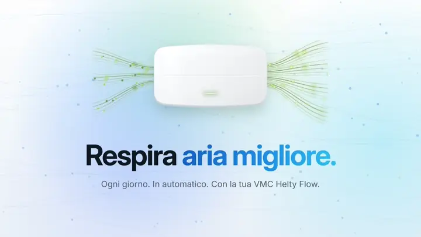
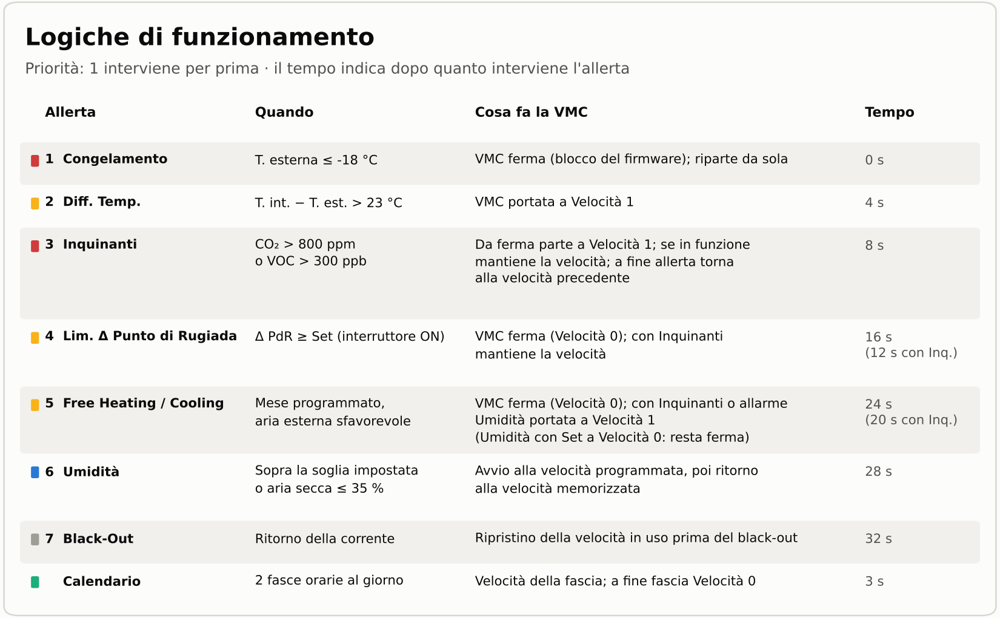
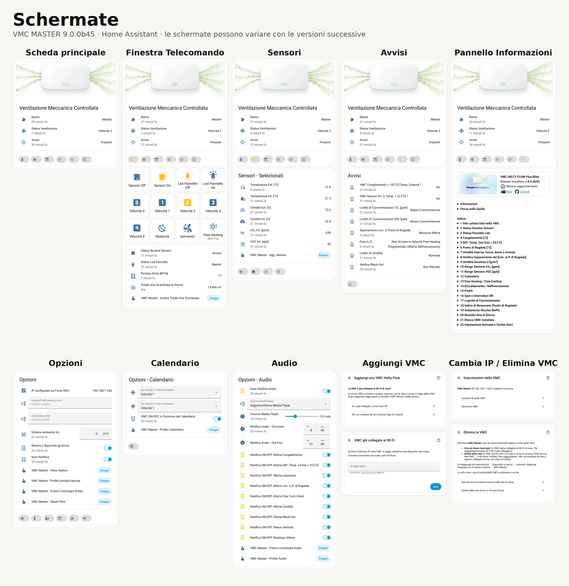
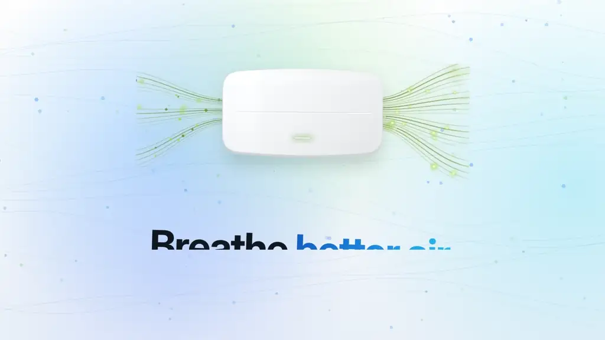
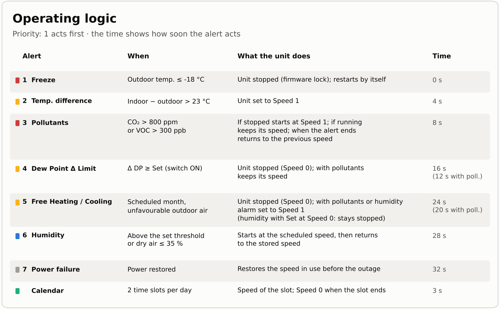
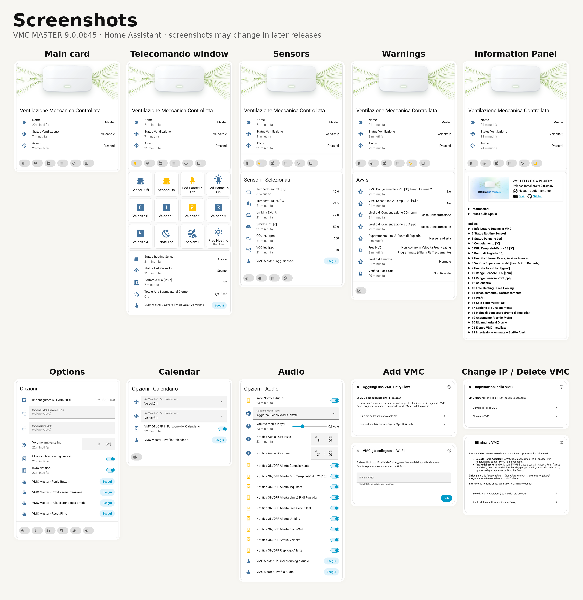

<p align="center">
  <a href="https://github.com/DanRobo76/VMC-HELTY-FLOW-MARKETPLACE/raw/main/Video/VMC_MASTER_promo_IT.mp4">
    
  </a>
  <br>
  <sub>Video di presentazione · 1 minuto e 17 secondi · clicca per scaricarlo</sub>
</p>

---

<p align="center">
  <strong>Scegli la lingua / Choose your language:</strong>
</p>

<details>
  <summary>🇮🇹 <strong>ITALIANO (Clicca per espandere)</strong></summary>

<h1 align="center">
  VMC MASTER
  <a href="https://www.home-assistant.io/" target="_blank">
    
  </a>
  <a href="https://www.heltyair.com/prodotti/vmc-a-parete/flow-plus/" target="_blank">
    
  </a>
</h1>

<p align="center">
  <strong>La tua ventilazione meccanica controllata in Home Assistant.</strong><br>
  Integrazione per VMC Helty Flow Plus / Elite: si installa dal Marketplace di Home Assistant e ogni VMC si aggiunge con il suo IP, senza copiare file né incollare codice.
</p>

<p align="center">
  Hai già provato <strong><a href="https://github.com/DanRobo76/Aspiratore">ASPIRATORE MASTER</a></strong>?
</p>

---
<details>
<summary><strong>Perché VMC MASTER</strong></summary>

<sub>**VMC MASTER** è un'integrazione per Home Assistant progettata per la gestione delle VMC **Helty Flow Plus / Elite** (le stesse che si comandano con l'app Air Guard). L'app funziona solo con il telefono collegato al Wi-Fi di casa; con Home Assistant la VMC si comanda in casa e anche da fuori casa.</sub>
<br>
<sub>Non è un semplice telecomando, ma una logica evoluta che confronta in continuo le condizioni interne ed esterne (temperatura, umidità, punto di rugiada, inquinanti) e decide se e a quale velocità far funzionare la VMC, con priorità precise tra le allerte e la ripresa automatica della velocità impostata.</sub>
<br>
<sub>Dal Marketplace arrivano anche gli aggiornamenti: basta premere **Aggiorna** e riavviare.</sub>
</details>

<details>
<summary><strong>Cosa lo rende diverso</strong></summary>

| <sub>Funzione</sub> | <sub>Vantaggio</sub> |
|---|---|
| <sub>**Installazione dal Marketplace**</sub> | <sub>Nessun file da copiare e nessun codice da incollare; gli aggiornamenti arrivano dal Marketplace</sub> |
| <sub>**Logiche con priorità**</sub> | <sub>Congelamento, Δ temperatura, inquinanti, punto di rugiada, Free Cooling / Free Heating, umidità e black-out gestiti in un ordine preciso, con ripresa automatica</sub> |
| <sub>**Controllo del punto di rugiada**</sub> | <sub>La VMC si arresta quando porterebbe in casa umidità dall'esterno</sub> |
| <sub>**Free Cooling / Free Heating**</sub> | <sub>Nessun raffrescamento o riscaldamento indesiderato nei mesi programmati; aria calda o fresca gratuita quando conviene</sub> |
| <sub>**Qualità dell'aria**</sub> | <sub>Avvio e arresto in funzione di CO₂ e VOC (sensori della VMC Flow Elite; CO₂ anche da un'entità di Home Assistant)</sub> |
| <sub>**Controllo dell'umidità interna**</sub> | <sub>Avvio automatico alla velocità programmata, anche con aria secca (≤ 35%), e ritorno alla velocità memorizzata</sub> |
| <sub>**Calendario**</sub> | <sub>2 fasce orarie per ogni giorno della settimana e 2 fasce mensili</sub> |
| <sub>**Selezione dinamica delle entità**</sub> | <sub>Sensori di Home Assistant e servizi meteo al posto dei sensori della VMC, con offset</sub> |
| <sub>**Intestazione animata**</sub> | <sub>Il flusso d'aria scorre in funzione della portata e il colore del LED indica lo stato: bianco normale, giallo allerta (che respira a VMC ferma con Avvisi presenti), blu umidità, rosso inquinanti, grigio OFF-Line; la scritta «Alert» sotto i tasti avvisa prima di avviare la VMC</sub> |
| <sub>**Avvisi e notifiche**</sub> | <sub>Su dispositivo mobile e tramite Media Player</sub> |
| <sub>**Più VMC**</sub> | <sub>Ogni VMC si aggiunge da *Dispositivi e servizi*: per una VMC già in rete basta l'IP</sub> |
| <sub>**Prima installazione**</sub> | <sub>Collegamento della VMC nuova al Wi-Fi di casa da *Aggiungi dispositivo*, senza l'App Air Guard</sub> |
</details>

<details>
<summary><strong>Funzionalità complete</strong></summary>

- <sub>Permette di selezionare quali Avvisi ascoltare tramite il Media Player selezionato.</sub>
- <sub>Permette di selezionare le entità Media Player, per ascoltare lo stato degli Avvisi e la Velocità.</sub>
- <sub>Indicatore Andamento Rischio Muffa.</sub>
- <sub>Indicatore che converte il punto di rugiada (TPdR) in una classificazione qualitativa del comfort igrometrico all'interno dell'ambiente.</sub>
- <sub>Visualizza in tempo reale: il numero totale di ricambi d'aria effettuati nella giornata, il volume totale di aria scambiata (m³) e il tempo rimanente prima del prossimo ricambio completo [Cliccare su Telecomando].</sub>
- <sub>Mostra in tempo reale il «Tempo Mancante» di ogni attesa dell'automazione (es. «Annullamento Memoria Free Heating», «Cambio Velocità per Lim. Δ PdR», «Ripristino dopo Black-Out») e la «Velocità Registrata» che verrà ripristinata a fine allerta, in un riquadro compatto sotto il pannello VMC.</sub>
- <sub>I tempi di attesa dei trigger dell'automazione sono fissi e non vanno modificati: non compaiono nella scheda e il Profilo Inizializzazione li riporta ai valori originali.</sub>
- <sub>L'automazione esegue gli eventi uno alla volta, nell'ordine in cui arrivano: nessun evento interrompe un comando già avviato (zero collisioni); un evento si esegue solo se la sua condizione è ancora vera quando arriva il suo turno; durante un Black-Out i cicli di conferma della velocità si fermano come prima e, se il Black-Out arriva mentre un'allerta sta finendo, al ripristino la VMC torna alla velocità di fine allerta; ogni ciclo di conferma si ferma se l'utente sceglie un'altra velocità.</sub>
- <sub>Mostra il tempo che manca alla prossima lettura della VMC da parte di Home Assistant e, sotto ogni voce, da quanto tempo è avvenuta l'ultima lettura: Ping, Sensori Ventilazione, Sensori Ambientali, Sensori Lan e Sensore Nome [Sensori - Selezionati → Timer Lettura Dati VMC].</sub>
- <sub>Nella finestra Telecomando il tasto della velocità attiva è illuminato e quello della velocità da ripristinare è illuminato con l'icona ↺ I tasti Sensori e Led Pannello illuminano lo stato attuale (On oppure Off); con «Verificare Filtro» il tasto «Led Pannello On» mostra l'icona del filtro.</sub>
- <sub>Elenca tutte le VMC installate in una tabella, una colonna per VMC [Pannello Informazioni → voce 21].</sub>
- <sub>Intestazione animata: flusso d'aria proporzionale alla portata e colore del LED in funzione dello stato; scritte «Alert», «Alert Δ Temp.» e «Alert Free» sotto i tasti di velocità quando un'allerta bloccherebbe o ridurrebbe la VMC [Pannello Informazioni → voce 22].</sub>
- <sub>Permette di selezionare le entità di: Temperatura (Interna ed Esterna), Umidità (Interna ed Esterna), Anidride Carbonica CO₂ (Interna) e Dispositivo Mobile, disponibili in Home Assistant, includendo anche le entità provenienti da fonti Meteo, per ottenere maggiore precisione e affidabilità rispetto ai sensori integrati della VMC.</sub>
- <sub>Toccando un sensore delle schede «Sensori - Selezionati», «Sensori - Extra» e «Sensori VMC Interni» si apre il grafico della sua cronologia; quando il dato non è disponibile il grafico mostra un buco e non 0. Brevi picchi verso il valore della sonda della VMC a ogni avvio di Home Assistant e dopo un aggiornamento sono normali: l'entità scelta non è ancora pronta e per pochi secondi si usa la sonda della VMC [Pannello Informazioni → voce 15, Nota Entità Scelte non Disponibili].</sub>
- <sub>Avvisa l'utente tramite notifica sul Dispositivo Mobile in caso di Avvio, Arresto, Errori o cambio filtro della VMC.</sub>
- <sub>Permette l'accensione e lo spegnimento automatico in funzione degli inquinanti (CO₂ e/o VOC) [sensori della VMC presenti solo nella VMC HELTY FLOW ELITE; per la CO₂ si può selezionare anche un'entità di Home Assistant].</sub>
- <sub>Permette l'accensione e lo spegnimento automatico in funzione dell'Umidità Interna Settata (sopra il valore impostato, oppure con aria secca ≤ 35% per far entrare aria dall'esterno).</sub>
- <sub>Gestisce più VMC, ognuna con la sua scheda (vedere *Installazione* e *Configurazione*).</sub>
- <sub>Collega al Wi-Fi di casa una VMC nuova senza l'App Air Guard (*Installazione → VMC nuova*); poi la VMC resta utilizzabile anche dall'App Air Guard.</sub>
- <sub>Permette lo spegnimento automatico in funzione della Temperatura Esterna ≤ -18 °C e successiva ripresa in funzione degli offset impostati.</sub>
  > <sub>**Nota:** per impostazione firmware, la priorità è assegnata al sensore interno della VMC rispetto al valore rilevato dal sensore esterno dell'entità selezionata.</sub>
- <sub>Permette l'avvio automatico a Velocità 1 in funzione della Differenza Temperatura Interna - Temperatura Esterna se > 23 °C e successiva ripresa.</sub>
  > <sub>**Nota:** per impostazione firmware, la priorità è assegnata ai sensori interni della VMC rispetto ai valori rilevati dal sensore esterno dell'entità selezionata.</sub>
- <sub>Permette di cambiare l'IP della VMC dall'interfaccia utente («Cambia IP VMC (Riavvio di H.A.)»).</sub>
- <sub>Permette di rinominare la VMC dall'interfaccia utente («Cambia Nome VMC»).</sub>
- <sub>Permette il controllo remoto e locale della VMC.</sub>
- <sub>Permette l'accensione e lo spegnimento in funzione di 2 fasce orarie programmabili per ogni giorno della settimana.</sub>
- <sub>Permette l'accensione e lo spegnimento in funzione di 2 fasce mensili programmabili (Free Heating / Free Cooling), evitando raffrescamento o riscaldamento indesiderato.</sub>
- <sub>Permette l'accensione e lo spegnimento in funzione dei parametri ambientali.</sub>
- <sub>Ripristina la velocità in caso di Black-Out (se la VMC ha linea dedicata al quadro elettrico e/o è installato un relè domotico); durante una fascia del Calendario, al ritorno della corrente, la VMC riparte con la velocità della fascia in corso.</sub>
- <sub>Calcola il tempo di ricambio d'aria in funzione della velocità.</sub>
- <sub>Calcola la portata d'aria (m³/h) in funzione della velocità.</sub>
- <sub>Calcola l'umidità assoluta esterna e interna (g/m³).</sub>
- <sub>Pulisce la cronologia delle entità del Package mostrando prima, in un riquadro di conferma, il numero e l'elenco delle entità coinvolte e quante di esse sono registrate nel database (le entità escluse sono indicate in un unico elenco nella sezione «recorder» del package).</sub>
- <sub>Mostra avvisi in funzione di:</sub>
  - <sub>sensori CO₂ e/o VOC;</sub>
  - <sub>sensore umidità;</sub>
  - <sub>congelamento;</sub>
  - <sub>differenza tra temperatura interna ed esterna;</sub>
  - <sub>superamento del Set Lim. Δ Punto di Rugiada;</sub>
  - <sub>riscaldamento o raffrescamento indesiderato (Free Heating / Free Cooling).</sub>
- <sub>Mostra sulla scheda se c'è un aggiornamento disponibile, anche per le versioni beta (l'avviso arriva dal Marketplace).</sub>
- <sub>Permette di selezionare la "Condizione Climatica Esterna" da introdurre tramite il "Set Lim. Δ Punto di Rugiada".</sub>

<br>

<sub>**Servizi da usare nelle proprie automazioni e script.** Ogni servizio invia un comando alla VMC. Qui la VMC si chiama `master`: per un'altra VMC sostituire `master` con il suo nome.</sub>

| <sub>Servizio</sub> | <sub>Cosa fa</sub> |
|---|---|
| <sub>`shell_command.vmc_master_velocita_0`</sub> | <sub>Ferma la VMC (Velocità 0)</sub> |
| <sub>`shell_command.vmc_master_velocita_1`</sub> | <sub>Velocità 1</sub> |
| <sub>`shell_command.vmc_master_velocita_2`</sub> | <sub>Velocità 2</sub> |
| <sub>`shell_command.vmc_master_velocita_3`</sub> | <sub>Velocità 3</sub> |
| <sub>`shell_command.vmc_master_velocita_4`</sub> | <sub>Velocità 4</sub> |
| <sub>`shell_command.vmc_master_notturna`</sub> | <sub>Velocità Notturna</sub> |
| <sub>`shell_command.vmc_master_iperventilazione`</sub> | <sub>Iperventilazione</sub> |
| <sub>`shell_command.vmc_master_freecooling`</sub> | <sub>Free Cooling / Free Heating</sub> |
| <sub>`shell_command.vmc_master_sensori_on`</sub> | <sub>Accende i sensori della VMC</sub> |
| <sub>`shell_command.vmc_master_sensori_off`</sub> | <sub>Spegne i sensori della VMC</sub> |
| <sub>`shell_command.vmc_master_pannello_led_on`</sub> | <sub>Accende i LED del pannello</sub> |
| <sub>`shell_command.vmc_master_pannello_led_off`</sub> | <sub>Spegne i LED del pannello</sub> |
| <sub>`shell_command.vmc_master_reset_filtro`</sub> | <sub>Azzera il contatore del filtro</sub> |

<sub>Esempio: ogni sera alle 22:00 la VMC passa alla Velocità 1.</sub>

```yaml
alias: VMC a Velocità 1 alle 22
triggers:
  - trigger: time
    at: "22:00:00"
actions:
  - action: shell_command.vmc_master_velocita_1
```

<sub>Per usarlo: *Impostazioni → Automazioni e scenari → Crea automazione → Crea nuova automazione*, menu **⋮** in alto a destra → **Modifica in YAML**, incollare il testo e premere **Salva**.</sub>
</details>

<details>
<summary><strong>Scenario tipico</strong></summary>

<sub>Un classico caso d'uso è un'abitazione con:</sub>
- <sub>VMC Helty Flow Plus o Flow Elite collegata alla rete di casa (con l'app Air Guard oppure da *Aggiungi dispositivo* dell'integrazione)</sub>
- <sub>Home Assistant 2026.11 o successivo</sub>
- <sub>sensori di temperatura e umidità, interni ed esterni, oppure un servizio meteo</sub>
- <sub>un dispositivo mobile per le notifiche</sub>

<sub>**Risultato:** la VMC ventila quando serve, si ferma quando l'aria esterna porterebbe umidità, freddo o caldo indesiderati e riparte da sola alla velocità impostata.</sub>
</details>

<details>
  <summary><strong>Requisiti</strong></summary>

- <sub>**[Home Assistant](https://www.home-assistant.io/installation/) 2026.11** o successivo, con il Marketplace integrato. La versione si legge in *Impostazioni → Informazioni*.</sub>
- <sub>VMC **Helty Flow Plus** oppure **Flow Elite**, quelle dell'app **[Air Guard](https://play.google.com/store/apps/details?id=com.helty.heltyair&hl=it&gl=US&pli=1)**</sub>
- <sub>Indirizzo IP della VMC statico (impostato nel router); la VMC risponde sulla porta 5001</sub>
- <sub>**Solo per collegare al Wi-Fi di casa una VMC nuova senza l'App Air Guard:** Home Assistant OS con il Supervisor, installato su un computer dotato di scheda Wi-Fi integrata oppure con una chiavetta USB Wi-Fi compatibile collegata; la scheda deve risultare tra le interfacce di rete di Home Assistant (Impostazioni → Sistema → Rete).</sub>
<br>

> <sub>⚠️ **ATTENZIONE!** Se la VMC utilizza un'app diversa da **Air Guard**, il codice molto probabilmente non sarà compatibile 🧰.</sub>
</details>

<details>
<summary><strong>Configurazione</strong></summary>

Dopo l'installazione tutto si regola dall'interfaccia, senza modificare lo YAML.

**Dalla scheda «VMC Master»:**
- indirizzo IP e nome della VMC («Cambia IP VMC (Riavvio di H.A.)» e «Cambia Nome VMC»);
- selezione delle entità: Temperatura (interna ed esterna), Umidità (interna ed esterna), CO₂ interna, Dispositivo Mobile e Media Player;
- offset dei sensori;
- `Set Lim. Δ Punto di Rugiada` e Condizione Climatica Esterna;
- calendario (2 fasce orarie per ogni giorno) e mesi di Free Heating / Free Cooling;
- interruttori ON/OFF di ogni funzione: inquinanti, punto di rugiada, Free Cooling, Free Heating, umidità, calendario;
- notifiche audio: Media Player, volume, orari e categorie di allerta.

Ogni script chiede conferma con il popup «Vuoi Procedere?». Per i dettagli aprire il **Pannello Informazioni** della scheda, con 22 voci illustrate.

**Da *Impostazioni → Dispositivi e servizi → VMC Master*:**
- **nome della VMC**: la riga mostra il nome dell'App Air Guard e si aggiorna a ogni avvio; con **tre puntini → Rinomina** se ne può mostrare un altro. Il nome interno (cartella, entità, scheda) non cambia;
- **cambiare l'IP**: icona ingranaggio sulla riga della VMC → **«Cambia l'IP della VMC»**, in alternativa al campo della scheda;
- **eliminare una VMC**: icona ingranaggio → **«Elimina la VMC»**, poi:
  - **«Solo da Home Assistant»**: la VMC resta collegata al Wi-Fi di casa e si può riaggiungere scrivendo solo l'IP;
  - **«Anche dalla rete»**: la VMC lascia il Wi-Fi di casa e torna in Access Point, cioè mostra di nuovo la sua rete VMC_…; per ricollegarla: **Aggiungi dispositivo → «No, va installata da zero»**, oppure l'App Air Guard.

  In tutti e due i casi la cartella va in `config/vmc_master_backup`: poi riavviare e togliere la sua scheda. Anche **tre puntini → Elimina** funziona, ma elimina la VMC solo da Home Assistant.
</details>

<details>
<summary><strong>Installazione</strong></summary>

1. **Modificare `configuration.yaml`** (una volta sola):
   - installare l'app **File editor**: *Impostazioni → Applicazioni → Installa app → File editor → Installa*, poi **Avvia** e **Apri l'interfaccia web**;
   - aprire `configuration.yaml` con l'icona della **cartella** in alto a sinistra e aggiungere in fondo:

     ```yaml
     homeassistant:
       packages: !include_dir_named packages/
     ```

     Se la riga `homeassistant:` c'è già, aggiungere subito sotto solo la seconda riga, con due spazi davanti;
   - solo per gli Avvisi audio, aggiungere in fondo anche:

     ```yaml
     tts:
       - platform: google_translate
     ```

     Servono proprio queste righe: aggiungere Google Translate solo da *Impostazioni → Dispositivi e servizi* non basta e gli avvisi audio resterebbero muti;
   - salvare con l'icona del **dischetto**.
2. **Aggiungere il repository**: *Impostazioni → Marketplace → ⋮ → Repository personalizzate*, scrivere `https://github.com/DanRobo76/VMC-HELTY-FLOW-MARKETPLACE`, scegliere il tipo **Integrazione**, premere **Aggiungi** e chiudere la finestra.
3. **Installare**: cercare **VMC Master** nel Marketplace e premere **Installa**.
4. **Riavviare**: *Impostazioni → Strumenti → YAML → Riavvia → Riavvia Home Assistant*.
5. **Aggiungere la VMC**: *Impostazioni → Dispositivi e servizi → + Aggiungi integrazione → VMC Master*:
   - VMC già collegata al Wi-Fi di casa: **«Sì, è già collegata: scrivo solo l'IP»**, scrivere l'IP (si legge nell'elenco dei dispositivi del router) e premere **Invia**;
   - VMC nuova, mai collegata: vedere **VMC nuova** qui sotto;
   - nelle finestre successive (il nome, dalla seconda VMC in poi; «VMC non raggiungibile» se la VMC è spenta) premere **Invia**, poi **Finito**.
6. **Riavviare**: in *Impostazioni* cliccare **«VMC Master: riavviare Home Assistant»** e premere **Invia**.
7. **Aggiungere la scheda**: premere **Ctrl+F5**. La plancia **Panoramica** automatica non accetta schede: se non c'è un'altra plancia, crearla da *Impostazioni → Plance → Aggiungi plancia → Nuova plancia da zero*. Nella plancia: **matita → Aggiungi scheda → VMC Master**, scegliere la VMC, **Salva** e **Fatto**.
8. **Una volta per ogni VMC**: nel pannello **Opzioni** della scheda premere **Esegui** su **«VMC ‹nome› - Profilo Inizializzazione»** e confermare con **OK**: Home Assistant si riavvia da solo. Poi, sempre in **Opzioni**, premere **Sensori Opzionati** e scegliere i sensori.

**Altre VMC**: *Impostazioni → Dispositivi e servizi → VMC Master → Aggiungi dispositivo*, poi come dal punto 5. Si possono aggiungere più VMC e riavviare una volta sola.

**VMC nuova** (senza l'App Air Guard, vedere *Requisiti*):
1. accendere la VMC: crea la rete `VMC_xxxxxxxx`;
2. al punto 5 scegliere **«No, va installata da zero»**;
3. scegliere la rete `VMC_xxxxxxxx` (password `12345678`), poi la rete di casa con la sua password, e premere **Invia**;
4. attendere da 1 a 3 minuti; se la finestra si chiude, ripetere il punto 5 e scegliere **«Continua con la VMC appena collegata»**;
5. prenotare sul router un IP fisso per il MAC mostrato; se è diverso dall'IP mostrato, togliere e ridare corrente alla VMC, scriverlo e premere **Invia**;
6. premere **Invia** nelle finestre successive, poi **Finito**, e continuare dal punto 6.

Se il collegamento non riesce, la finestra mostra il motivo e permette di riprovare.

**Aggiornare**: quando il Marketplace segnala una nuova versione premere **Aggiorna**, poi riavviare Home Assistant. Per controllare subito: pagina di VMC Master **⋮ → Aggiorna le informazioni**. I file del package non vanno modificati: un file modificato a mano viene ripristinato all'avvio (la copia resta in `config/vmc_master_backup`).

</details>

<details>
<summary><strong>Logiche di funzionamento</strong></summary>

<sub>La tabella riassume priorità, comportamento della VMC e tempi di intervento di ogni allerta. Il dettaglio completo è nel Pannello Informazioni, voce 17.</sub>


</details>

<details>
<summary><strong>Schermate</strong></summary>

<sub>Le schermate possono variare in funzione dell'ultima versione rilasciata.</sub>


</details>

<details>
<summary><strong>Licenza</strong></summary>

<sub>**[GNU General Public License v3.0](LICENSE)**. Copyright © 2023-2026 Ing. Danilo Robotti. È consentito usare, copiare, modificare e distribuire il software, anche per scopi commerciali; chi lo distribuisce, anche modificato, deve renderne disponibile il codice sorgente con la stessa licenza e mantenere la nota di copyright. Il software è fornito senza alcuna garanzia.</sub>

<sub>**Impiego dell'Intelligenza Artificiale:** nello sviluppo del software l'autore si è avvalso anche di strumenti di intelligenza artificiale.</sub>
</details>

<details>
<summary><strong>Esonero di responsabilità</strong></summary>

<sub>Il software è fornito «così com'è», senza garanzie di alcun tipo. In nessun caso lo sviluppatore sarà responsabile di danneggiamenti diretti, indiretti o conseguenti, correlati a difetti del presente software. L'utente ha l'onere e la responsabilità della scelta, dell'installazione, dell'uso e della gestione del software al fine del raggiungimento del risultato prefissatosi.</sub>
</details>

---
<p align="center">
  Se il progetto ti è stato utile, puoi
  <a href="https://www.paypal.com/ncp/payment/8LT4JJW7MHW6U">
    offrirmi un ginseng ☕ e supportarne lo sviluppo
  </a>.
  <br><br>
  Clicca sul link oppure scansiona il QR code qui sotto.
  <br><br>
  <a href="https://www.paypal.com/ncp/payment/8LT4JJW7MHW6U">
    
  </a>
  <br><br>
  Grazie per il tuo supporto!
</p>

</details>

<details>
  <summary>🇺🇸 <strong>ENGLISH (Click to expand)</strong></summary>

<h1 align="center">
  VMC MASTER
  <a href="https://www.home-assistant.io/" target="_blank">
    
  </a>
  <a href="https://www.heltyair.com/prodotti/vmc-a-parete/flow-plus/" target="_blank">
    
  </a>
</h1>

<p align="center">
  <strong>Your mechanical ventilation, controlled in Home Assistant.</strong><br>
  Integration for Helty Flow Plus / Elite MVHR units: install it from the Home Assistant Marketplace and add each unit with its IP, with no files to copy and no code to paste.
</p>

<p align="center">
  <a href="https://github.com/DanRobo76/VMC-HELTY-FLOW-MARKETPLACE/raw/main/Video/VMC_MASTER_promo_EN.mp4">
    
  </a>
  <br>
  <sub>Presentation video · 1 minute 17 seconds · click to download</sub>
</p>

<p align="center">
  Have you tried <strong><a href="https://github.com/DanRobo76/Aspiratore">ASPIRATORE MASTER</a></strong>?
</p>

---
<details>
<summary><strong>Why VMC MASTER</strong></summary>

<sub>**VMC MASTER** is a Home Assistant integration designed to manage **Helty Flow Plus / Elite** ventilation units (the same ones controlled with the Air Guard app). The app only works with the phone on the home Wi-Fi; with Home Assistant the unit can be controlled at home and away from home.</sub>
<br>
<sub>It is not just a remote control, but an evolved logic that continuously compares indoor and outdoor conditions (temperature, humidity, dew point, pollutants) and decides whether and at which speed the unit should run, with precise priorities between alerts and automatic return to the set speed.</sub>
<br>
<sub>Updates come from the Marketplace too: press **Update** and restart.</sub>
</details>

<details>
<summary><strong>What makes it different</strong></summary>

| <sub>Function</sub> | <sub>Advantage</sub> |
|---|---|
| <sub>**Marketplace install**</sub> | <sub>No files to copy and no code to paste; updates come from the Marketplace</sub> |
| <sub>**Prioritized logic**</sub> | <sub>Freezing, temperature Δ, pollutants, dew point, Free Cooling / Free Heating, humidity and power failure handled in a precise order, with automatic recovery</sub> |
| <sub>**Dew point control**</sub> | <sub>The unit stops when it would bring outdoor humidity indoors</sub> |
| <sub>**Free Cooling / Free Heating**</sub> | <sub>No unwanted cooling or heating in the scheduled months; free warm or cool air when it pays off</sub> |
| <sub>**Air quality**</sub> | <sub>Start and stop based on CO₂ and VOC (Flow Elite sensors; CO₂ also from a Home Assistant entity)</sub> |
| <sub>**Indoor humidity control**</sub> | <sub>Automatic start at the scheduled speed, also with dry air (≤ 35%), and return to the stored speed</sub> |
| <sub>**Calendar**</sub> | <sub>2 time slots for each day of the week and 2 monthly periods</sub> |
| <sub>**Dynamic entity selection**</sub> | <sub>Home Assistant sensors and weather services instead of the unit's own sensors, with offsets</sub> |
| <sub>**Animated header**</sub> | <sub>The airflow moves according to the flow rate and the LED colour shows the state: white normal, yellow alert (breathing when the unit is stopped with warnings present), blue humidity, red pollutants, grey off-line; the «Alert» label under the buttons warns before starting the unit</sub> |
| <sub>**Alerts and notifications**</sub> | <sub>On mobile devices and through Media Players</sub> |
| <sub>**Multiple units**</sub> | <sub>Each unit is added from *Devices & services*: for a unit already on the network the IP is enough</sub> |
| <sub>**First installation**</sub> | <sub>Connect a new unit to the home Wi-Fi from *Add device*, without the Air Guard app</sub> |
</details>

<details>
<summary><strong>Requirements</strong></summary>

- <sub>**[Home Assistant](https://www.home-assistant.io/installation/) 2026.11** or later, with the built-in Marketplace. The version is shown in *Settings → About*.</sub>
- <sub>**Helty Flow Plus** or **Flow Elite** unit, the ones of the **[Air Guard](https://play.google.com/store/apps/details?id=com.helty.heltyair&hl=it&gl=US&pli=1)** app</sub>
- <sub>Static IP address for the unit (set in the router); the unit answers on port 5001</sub>
- <sub>**Only to connect a new unit to the home Wi-Fi without the Air Guard app:** Home Assistant OS with the Supervisor, on a computer with a built-in Wi-Fi card or a compatible USB Wi-Fi dongle, listed among the network interfaces (*Settings → System → Network*).</sub>

> <sub>⚠️ **WARNING!** If the unit uses an app other than **Air Guard**, the code will most likely not be compatible 🧰.</sub>
</details>

<details>
<summary><strong>Configuration</strong></summary>

After installation everything is set from the interface, without editing YAML.

**From the «VMC Master» card:**
- unit IP address and name («Cambia IP VMC (Riavvio di H.A.)» and «Cambia Nome VMC»);
- entity selection: Temperature (indoor and outdoor), Humidity (indoor and outdoor), indoor CO₂, Mobile Device and Media Player;
- sensor offsets;
- `Set Lim. Δ Punto di Rugiada` (dew point Δ limit) and outdoor climate condition;
- calendar (2 time slots per day) and Free Heating / Free Cooling months;
- ON/OFF switches for each function: pollutants, dew point, Free Cooling, Free Heating, humidity, calendar;
- audio notifications: Media Player, volume, time window and alert categories.

Every script asks for confirmation with the «Vuoi Procedere?» popup. For details open the card's **Pannello Informazioni**.

**From *Settings → Devices & services → VMC Master*:**
- **unit name**: the row shows the Air Guard name and is refreshed at every start; **three dots → Rename** shows another one. The internal name (folder, entities, card) never changes;
- **change the IP**: gear icon on the unit's row → **«Change the unit's IP»**, as an alternative to the card field;
- **delete a unit**: gear icon → **«Delete the unit»**, then **«Only from Home Assistant»** (the unit stays on the home Wi-Fi) or **«From the network too»** (the unit goes back to Access Point mode and shows its VMC_… network again). In both cases the folder goes to `config/vmc_master_backup`; then restart and remove its card. **Three dots → Delete** also works, but only removes the unit from Home Assistant.
</details>

<details>
<summary><strong>Installation</strong></summary>

1. **Edit `configuration.yaml`** (once):
   - install the **File editor** app: *Settings → Apps → Install app → File editor → Install*, then **Start** and **Open web UI**;
   - open `configuration.yaml` with the **folder** icon at the top left and add at the end:

     ```yaml
     homeassistant:
       packages: !include_dir_named packages/
     ```

     If the `homeassistant:` line is already there, add only the second line right below it, with two spaces in front;
   - only for audio alerts, also add at the end:

     ```yaml
     tts:
       - platform: google_translate
     ```

     These exact lines are needed: adding Google Translate only from *Settings → Devices & services* is not enough and the audio alerts stay silent;
   - save with the **disk** icon.
2. **Add the repository**: *Settings → Marketplace → ⋮ → Custom repositories*, enter `https://github.com/DanRobo76/VMC-HELTY-FLOW-MARKETPLACE`, set the type to **Integration**, press **Add** and close the window.
3. **Install**: search for **VMC Master** in the Marketplace and press **Install**.
4. **Restart**: *Settings → Tools → YAML → Restart → Restart Home Assistant*.
5. **Add the unit**: *Settings → Devices & services → + Add integration → VMC Master*:
   - unit already on the home Wi-Fi: **«Yes, it is connected: I only enter the IP»**, type the IP (shown in the router's device list) and press **Submit**;
   - new unit, never connected: see **New unit** below;
   - in the next windows (the name, from the second unit on; «Unit not reachable» if the unit is off) press **Submit**, then **Finish**.
6. **Restart**: in *Settings* click **«VMC Master: restart Home Assistant»** and press **Submit**.
7. **Add the card**: press **Ctrl+F5**. The automatic **Overview** dashboard does not accept cards: if there is no other dashboard, create one from *Settings → Dashboards → Add dashboard → New dashboard from scratch*. On that dashboard: **pencil → Add card → VMC Master**, pick the unit, **Save** and **Done**.
8. **Once per unit**: in the card's **Opzioni** panel press **Esegui** on **«VMC ‹name› - Profilo Inizializzazione»** and confirm with **OK**: Home Assistant restarts by itself. Then, still in **Opzioni**, press **Sensori Opzionati** and pick the sensors.

**More units**: *Settings → Devices & services → VMC Master → Add device*, then as from step 5. You can add several units and restart once.

**New unit** (without the Air Guard app, see *Requirements*):
1. power on the unit: it creates the `VMC_xxxxxxxx` network;
2. at step 5 choose **«No, it must be set up from scratch»**;
3. pick the `VMC_xxxxxxxx` network (password `12345678`), then the home network and its password, and press **Submit**;
4. wait 1 to 3 minutes; if the window closes, repeat step 5 and choose **«Continue with the unit just connected»**;
5. reserve a fixed IP on the router for the MAC shown; if it differs from the IP shown, power the unit off and on, type it and press **Submit**;
6. press **Submit** in the next windows, then **Finish**, and continue from step 6.

If the connection fails, the window shows the reason and lets you retry.

**Update**: when the Marketplace shows a new version press **Update**, then restart Home Assistant. To check at once: VMC Master page **⋮ → Refresh information**. Do not edit the package files: a hand-edited file is restored at startup (the copy stays in `config/vmc_master_backup`).

</details>

<details>
<summary><strong>Operating Logic</strong></summary>

<sub>The table summarises priority, unit behaviour and reaction time of each alert. Full details are in the card's Pannello Informazioni, item 17.</sub>


</details>

<details>
<summary><strong>Screenshots</strong></summary>

<sub>Screenshots may change with the latest release. The interface of the card is in Italian.</sub>


</details>

<details>
<summary><strong>License</strong></summary>

<sub>**[GNU General Public License v3.0](LICENSE)**. Copyright © 2023-2026 Ing. Danilo Robotti. You may use, copy, modify and distribute the software, also for commercial purposes; whoever distributes it, even modified, must make the source code available under the same licence and keep the copyright notice. The software comes with no warranty.</sub>

<sub>**Use of Artificial Intelligence:** in developing the software the author also used artificial intelligence tools.</sub>
</details>

<details>
<summary><strong>Disclaimer</strong></summary>

<sub>The software is provided "as is", without warranties of any kind. In no event shall the developer be liable for direct, indirect or consequential damages related to defects of this software. The user is solely responsible for choosing, installing, using and managing the software to achieve the intended result.</sub>
</details>

---
<p align="center">
  If this project was useful to you, you can
  <a href="https://www.paypal.com/ncp/payment/8LT4JJW7MHW6U">
    buy me a ginseng ☕ and support its development
  </a>.
  <br><br>
  Click the link or scan the QR code below.
  <br><br>
  <a href="https://www.paypal.com/ncp/payment/8LT4JJW7MHW6U">
    
  </a>
  <br><br>
  Thank you for your support!
</p>

</details>
