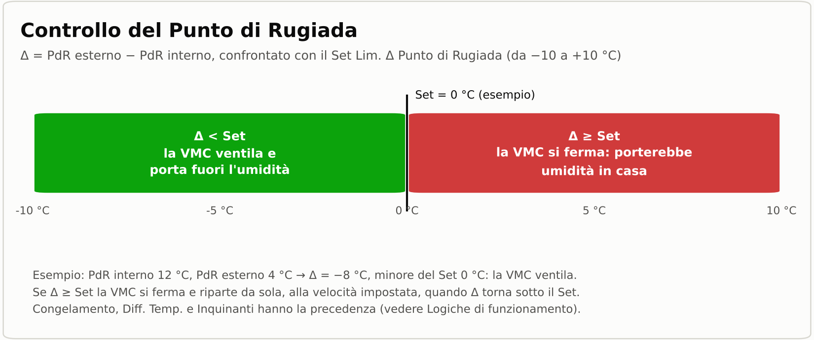
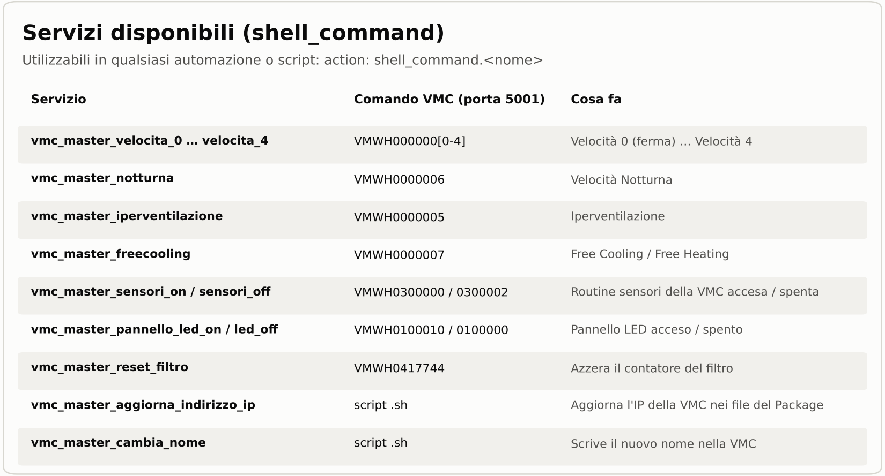
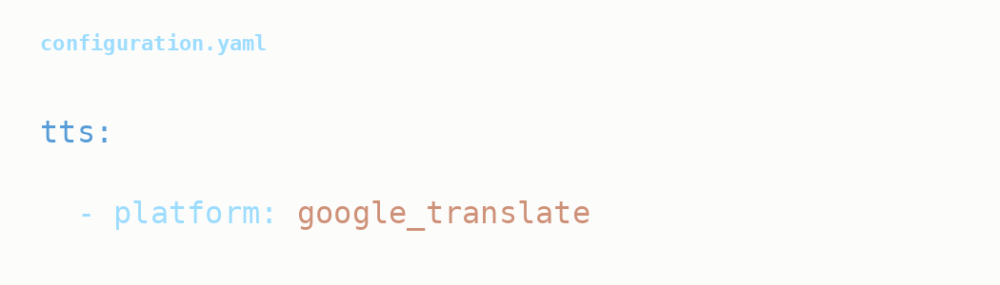

<p align="center">
  <a href="https://github.com/DanRobo76/VMC-HELTY-FLOW-MARKETPLACE/raw/main/Video/VMC_MASTER_promo_IT.mp4">
    
  </a>
  <br>
  <sub>Video di presentazione · 1 minuto e 17 secondi · clicca per scaricarlo</sub>
</p>

---

<p align="center">
  <strong>Scegli la lingua / Choose your language:</strong>
</p>

<details>
  <summary>🇮🇹 <strong>ITALIANO (Clicca per espandere)</strong></summary>

<h1 align="center">
  VMC MASTER
  <a href="https://www.home-assistant.io/" target="_blank">
    
  </a>
  <a href="https://www.heltyair.com/prodotti/vmc-a-parete/flow-plus/" target="_blank">
    
  </a>
</h1>

<p align="center">
  <strong>La tua ventilazione meccanica controllata in Home Assistant.</strong><br>
  Integrazione per VMC Helty Flow Plus / Elite: si installa dal Marketplace di Home Assistant e ogni VMC si aggiunge con il suo IP, senza copiare file né incollare codice.
</p>

<p align="center">
  Hai già provato <strong><a href="https://github.com/DanRobo76/Aspiratore">ASPIRATORE MASTER</a></strong> e <strong><a href="https://github.com/DanRobo76/VMC-HELTY-FLOW-LIGHT/tree/main">VMC Versione Light</a></strong>?
</p>

---
<details>
<summary><strong>Perché VMC MASTER</strong></summary>

<sub>**VMC MASTER** è un'integrazione per Home Assistant progettata per la gestione delle VMC **Helty Flow Plus / Elite** (gestite con l'app Air Guard), sia in locale sia da remoto.</sub>
<br>
<sub>Non è un semplice telecomando, ma una logica evoluta che confronta in continuo le condizioni interne ed esterne (temperatura, umidità, punto di rugiada, inquinanti) e decide se e a quale velocità far funzionare la VMC, con priorità precise tra le allerte e la ripresa automatica della velocità impostata.</sub>
<br>
<sub>Dal Marketplace arrivano anche gli aggiornamenti: basta premere **Aggiorna** e riavviare.</sub>
</details>

<details>
<summary><strong>Cosa lo rende diverso</strong></summary>

| <sub>Funzione</sub> | <sub>Vantaggio</sub> |
|---|---|
| <sub>**Installazione dal Marketplace**</sub> | <sub>Nessun file da copiare e nessun codice da incollare; gli aggiornamenti arrivano dal Marketplace</sub> |
| <sub>**Logiche con priorità**</sub> | <sub>Congelamento, Δ temperatura, inquinanti, punto di rugiada, Free Cooling / Free Heating, umidità e black-out gestiti in un ordine preciso, con ripresa automatica</sub> |
| <sub>**Controllo del punto di rugiada**</sub> | <sub>La VMC si arresta quando porterebbe in casa umidità dall'esterno</sub> |
| <sub>**Free Cooling / Free Heating**</sub> | <sub>Nessun raffrescamento o riscaldamento indesiderato nei mesi programmati; aria calda o fresca gratuita quando conviene</sub> |
| <sub>**Qualità dell'aria**</sub> | <sub>Avvio e arresto in funzione di CO₂ e VOC (sensori della VMC Flow Elite; CO₂ anche da un'entità di Home Assistant)</sub> |
| <sub>**Controllo dell'umidità interna**</sub> | <sub>Avvio automatico alla velocità programmata, anche con aria secca (≤ 35%), e ritorno alla velocità memorizzata</sub> |
| <sub>**Calendario**</sub> | <sub>2 fasce orarie per ogni giorno della settimana e 2 fasce mensili</sub> |
| <sub>**Selezione dinamica delle entità**</sub> | <sub>Sensori di Home Assistant e servizi meteo al posto dei sensori della VMC, con offset</sub> |
| <sub>**Intestazione animata**</sub> | <sub>Il flusso d'aria scorre in funzione della portata e il colore del LED indica lo stato: bianco normale, giallo allerta (che respira a VMC ferma con Avvisi presenti), blu umidità, rosso inquinanti, grigio OFF-Line; la scritta «Alert» sotto i tasti avvisa prima di avviare la VMC</sub> |
| <sub>**Avvisi e notifiche**</sub> | <sub>Su dispositivo mobile e tramite Media Player</sub> |
| <sub>**Più VMC**</sub> | <sub>Ogni VMC si aggiunge da *Dispositivi e servizi*: per una VMC già in rete basta l'IP; una sola scheda per tutte le VMC</sub> |
| <sub>**Prima installazione**</sub> | <sub>Collegamento della VMC nuova al Wi-Fi di casa da *Aggiungi dispositivo*, senza l'App Air Guard</sub> |
</details>

<details>
<summary><strong>Vantaggi principali</strong></summary>

- <sub>Installazione e aggiornamenti dal Marketplace di Home Assistant</sub>
- <sub>Configurazione dall'interfaccia, senza modificare lo YAML</sub>
- <sub>Controllo locale e remoto della VMC</sub>
- <sub>Ripresa automatica della velocità al termine di ogni allerta</sub>
- <sub>Ripristino della velocità dopo un black-out (VMC con linea dedicata nel quadro elettrico e/o relè domotico); durante una fascia del Calendario la VMC riparte con la velocità della fascia in corso</sub>
- <sub>Calcolo di ricambi d'aria, portata, umidità assoluta e comfort igrometrico</sub>
- <sub>Cambio dell'indirizzo IP e del nome della VMC dall'interfaccia</sub>
- <sub>Conferma prima di ogni script («Vuoi Procedere?»); conferma «Sì / No» per la pulizia della cronologia</sub>
- <sub>Pannello Informazioni con 22 voci illustrate che spiegano ogni funzione</sub>
</details>

<details>
<summary><strong>Funzionalità complete</strong></summary>

- <sub>Permette di selezionare quali Avvisi ascoltare tramite il Media Player selezionato.</sub>
- <sub>Permette di selezionare le entità Media Player, per ascoltare lo stato degli Avvisi e la Velocità.</sub>
- <sub>Indicatore Andamento Rischio Muffa.</sub>
- <sub>Indicatore che converte il punto di rugiada (TPdR) in una classificazione qualitativa del comfort igrometrico all'interno dell'ambiente.</sub>
- <sub>Visualizza in tempo reale: il numero totale di ricambi d'aria effettuati nella giornata, il volume totale di aria scambiata (m³) e il tempo rimanente prima del prossimo ricambio completo [Cliccare su Telecomando].</sub>
- <sub>Mostra in tempo reale il «Tempo Mancante» di ogni attesa dell'automazione (es. «Annullamento Memoria Free Heating», «Cambio Velocità per Lim. Δ PdR», «Ripristino dopo Black-Out») e la «Velocità Registrata» che verrà ripristinata a fine allerta, in un riquadro compatto sotto il pannello VMC.</sub>
- <sub>I tempi di attesa dei trigger dell'automazione sono fissi e non vanno modificati: non compaiono nella scheda e il Profilo Inizializzazione li riporta ai valori originali.</sub>
- <sub>L'automazione esegue gli eventi uno alla volta, nell'ordine in cui arrivano: nessun evento interrompe un comando già avviato (zero collisioni); un evento si esegue solo se la sua condizione è ancora vera quando arriva il suo turno; durante un Black-Out i cicli di conferma della velocità si fermano come prima e, se il Black-Out arriva mentre un'allerta sta finendo, al ripristino la VMC torna alla velocità di fine allerta; ogni ciclo di conferma si ferma se l'utente sceglie un'altra velocità.</sub>
- <sub>Mostra il tempo che manca alla prossima lettura della VMC da parte di Home Assistant e, sotto ogni voce, da quanto tempo è avvenuta l'ultima lettura: Ping, Sensori Ventilazione, Sensori Ambientali, Sensori Lan e Sensore Nome [Sensori - Selezionati → Timer Lettura Dati VMC].</sub>
- <sub>Nella finestra Telecomando il tasto della velocità attiva è illuminato e quello della velocità da ripristinare è illuminato con l'icona ↺ I tasti Sensori e Led Pannello illuminano lo stato attuale (On oppure Off); con «Verificare Filtro» il tasto «Led Pannello On» mostra l'icona del filtro.</sub>
- <sub>Elenca tutte le VMC installate in una tabella, una colonna per VMC [Pannello Informazioni → voce 21].</sub>
- <sub>Intestazione animata: flusso d'aria proporzionale alla portata e colore del LED in funzione dello stato; scritte «Alert», «Alert Δ Temp.» e «Alert Free» sotto i tasti di velocità quando un'allerta bloccherebbe o ridurrebbe la VMC [Pannello Informazioni → voce 22].</sub>
- <sub>Permette di selezionare le entità di: Temperatura (Interna ed Esterna), Umidità (Interna ed Esterna), Anidride Carbonica CO₂ (Interna) e Dispositivo Mobile, disponibili in Home Assistant, includendo anche le entità provenienti da fonti Meteo, per ottenere maggiore precisione e affidabilità rispetto ai sensori integrati della VMC.</sub>
- <sub>Toccando un sensore delle schede «Sensori - Selezionati», «Sensori - Extra» e «Sensori VMC Interni» si apre il grafico della sua cronologia; quando il dato non è disponibile il grafico mostra un buco e non 0. Brevi picchi verso il valore della sonda della VMC a ogni avvio di Home Assistant e dopo un aggiornamento sono normali: l'entità scelta non è ancora pronta e per pochi secondi si usa la sonda della VMC [Pannello Informazioni → voce 15, Nota Entità Scelte non Disponibili].</sub>
- <sub>Avvisa l'utente tramite notifica sul Dispositivo Mobile in caso di Avvio, Arresto, Errori o cambio filtro della VMC.</sub>
- <sub>Permette l'accensione e lo spegnimento automatico in funzione degli inquinanti (CO₂ e/o VOC) [sensori della VMC presenti solo nella VMC HELTY FLOW ELITE; per la CO₂ si può selezionare anche un'entità di Home Assistant].</sub>
- <sub>Permette l'accensione e lo spegnimento automatico in funzione dell'Umidità Interna Settata (sopra il valore impostato, oppure con aria secca ≤ 35% per far entrare aria dall'esterno).</sub>
- <sub>Se si dispone di più VMC, ognuna si aggiunge da *Impostazioni → Dispositivi e servizi → VMC Master → Aggiungi dispositivo* (se è già collegata al Wi-Fi basta l'IP: il nome si legge dalla VMC) e si elimina dalla stessa pagina con l'icona ingranaggio, scegliendo se lasciarla sulla rete di casa o rimandarla in Access Point (la sua cartella va in `config/vmc_master_backup`); una sola scheda «VMC Master» per tutte le VMC.</sub>
- <sub>Collega una VMC appena installata al Wi-Fi di casa senza l'App Air Guard, con gli stessi passaggi del manuale Helty, direttamente da *Aggiungi dispositivo* (risposta «No, va installata da zero»): ricerca della rete VMC_xxxxxxxx, invio della rete di casa, IP e MAC da prenotare sul router e, se qualcosa non va, la tabella dei lampeggi del LED. Richiede Home Assistant OS su un computer con scheda Wi-Fi integrata oppure con una chiavetta USB Wi-Fi collegata (vedere Requisiti). A installazione conclusa la VMC resta visibile e utilizzabile anche dall'App Air Guard, senza ripetere la procedura.</sub>
- <sub>Permette lo spegnimento automatico in funzione della Temperatura Esterna ≤ -18 °C e successiva ripresa in funzione degli offset impostati.</sub>
  > <sub>**Nota:** per impostazione firmware, la priorità è assegnata al sensore interno della VMC rispetto al valore rilevato dal sensore esterno dell'entità selezionata.</sub>
- <sub>Permette l'avvio automatico a Velocità 1 in funzione della Differenza Temperatura Interna - Temperatura Esterna se > 23 °C e successiva ripresa.</sub>
  > <sub>**Nota:** per impostazione firmware, la priorità è assegnata ai sensori interni della VMC rispetto ai valori rilevati dal sensore esterno dell'entità selezionata.</sub>
- <sub>Permette di cambiare l'IP della VMC dall'interfaccia utente («Cambia IP VMC (Riavvio di H.A.)»).</sub>
- <sub>Permette di rinominare la VMC dall'interfaccia utente («Cambia Nome VMC»).</sub>
- <sub>Permette il controllo remoto e locale della VMC.</sub>
- <sub>Permette l'accensione e lo spegnimento in funzione di 2 fasce orarie programmabili per ogni giorno della settimana.</sub>
- <sub>Permette l'accensione e lo spegnimento in funzione di 2 fasce mensili programmabili (Free Heating / Free Cooling), evitando raffrescamento o riscaldamento indesiderato.</sub>
- <sub>Permette l'accensione e lo spegnimento in funzione dei parametri ambientali.</sub>
- <sub>Ripristina la velocità in caso di Black-Out (se la VMC ha linea dedicata al quadro elettrico e/o è installato un relè domotico); durante una fascia del Calendario, al ritorno della corrente, la VMC riparte con la velocità della fascia in corso.</sub>
- <sub>Calcola il tempo di ricambio d'aria in funzione della velocità.</sub>
- <sub>Calcola la portata d'aria (m³/h) in funzione della velocità.</sub>
- <sub>Calcola l'umidità assoluta esterna e interna (g/m³).</sub>
- <sub>Pulisce la cronologia delle entità del Package mostrando prima, in un riquadro di conferma, il numero e l'elenco delle entità coinvolte e quante di esse sono registrate nel database (le entità escluse sono indicate in un unico elenco nella sezione «recorder» del package; il package è scritto dall'integrazione e viene riscritto a ogni avvio, quindi l'elenco non va modificato a mano).</sub>
- <sub>Mostra avvisi in funzione di:</sub>
  - <sub>sensori CO₂ e/o VOC;</sub>
  - <sub>sensore umidità;</sub>
  - <sub>congelamento;</sub>
  - <sub>differenza tra temperatura interna ed esterna;</sub>
  - <sub>superamento del Set Lim. Δ Punto di Rugiada;</sub>
  - <sub>riscaldamento o raffrescamento indesiderato (Free Heating / Free Cooling).</sub>
- <sub>Informa in caso di nuovo aggiornamento disponibile.</sub>
- <sub>Permette di selezionare la "Condizione Climatica Esterna" da introdurre tramite il "Set Lim. Δ Punto di Rugiada".</sub>

<br>



<sub>Il software calcola il Punto di Rugiada Esterno (PdR Ext.) e il Punto di Rugiada Interno (PdR Int.). Se la differenza tra il PdR Ext. e il PdR Int. è inferiore al "Set Lim. Δ Punto di Rugiada" (valore impostato dall'utente), la VMC garantirà un adeguato trasporto dell'umidità dall'interno all'esterno dell'edificio. Al contrario, se la differenza tra il PdR Ext. e il PdR Int. sarà maggiore o uguale al "Set Lim. Δ Punto di Rugiada", la VMC si arresterà per evitare il trasporto dell'umidità dall'esterno all'interno dell'edificio; la ripresa automatica sull'ultima velocità impostata è garantita non appena la differenza tra il PdR Ext. e il PdR Int. è inferiore al "Set Lim. Δ Punto di Rugiada". Le allerte con priorità maggiore (congelamento, Δ temperatura, inquinanti) prevalgono sul punto di rugiada: vedere "Logiche di funzionamento".</sub>

<br><br>

<sub>Permette l'utilizzo dei seguenti Servizi, da impiegare in qualsiasi Automazione, Script, etc.:</sub>


</details>

<details>
<summary><strong>Integrazione e installazione manuale: le differenze</strong></summary>

| <sub>Funzione</sub> | <sub>Manuale 8.6.0</sub> | <sub>Integrazione</sub> |
|---|---|---|
| <sub>Installare</sub> | <sub>Copiare i file e incollare automazione e scheda</sub> | <sub>*Marketplace → Installa*, poi l'IP della VMC</sub> |
| <sub>Aggiungere una VMC</sub> | <sub>Finestra Clona + incollare automazione e scheda</sub> | <sub>*Aggiungi dispositivo*: solo l'IP (il nome si legge dalla VMC), nient'altro da incollare</sub> |
| <sub>Cancellare una VMC</sub> | <sub>Finestra Clona + cancellare a mano automazione e scheda</sub> | <sub>Icona ingranaggio → «Elimina la VMC»: solo da Home Assistant o anche dalla rete (torna in Access Point); la cartella va in `config/vmc_master_backup`</sub> |
| <sub>Cambiare IP</sub> | <sub>Campo «Cambia IP VMC» della scheda</sub> | <sub>Lo stesso campo, oppure l'icona ingranaggio sulla VMC → «Cambia l'IP della VMC»</sub> |
| <sub>Cambiare nome della VMC</sub> | <sub>Campo «Cambia Nome VMC»</sub> | <sub>Invariato</sub> |
| <sub>Collegare al Wi-Fi una VMC nuova</sub> | <sub>Finestra Prima Installazione VMC della scheda Master</sub> | <sub>*Aggiungi dispositivo* → «No, va installata da zero» (stesso motore della 8.6.0)</sub> |
| <sub>Automazione principale</sub> | <sub>Incollata nell'editor (modificabile)</sub> | <sub>Nel package (`vmc_‹nome›_automazione.yaml`, sola lettura)</sub> |
| <sub>Aggiornare</sub> | <sub>Scaricare e sostituire i file</sub> | <sub>*Marketplace → Aggiorna*, poi riavviare</sub> |
| <sub>Nomi delle entità</sub> | <sub>`vmc_master_…`, `vmc_‹nome›_…`</sub> | <sub>Identici: la cronologia resta</sub> |

<sub>L'integrazione scrive in `config/packages/vmc_helty_flow/‹nome›` gli stessi file che la 8.6.0 crea con gli script Clona e Cambia IP. La Finestra Clona e la Finestra Prima Installazione VMC non ci sono più, perché le sostituisce *Aggiungi dispositivo*: nella scheda e nel package vengono tolti solo i blocchi fra i segnaposto «SEZIONE CLONA VMC» e «SEZIONE INSTALLA VMC», gli stessi che la 8.6.0 toglie già alle VMC clonate. Il collegamento al Wi-Fi usa lo stesso motore della 8.6.0.</sub>

<sub>Correzioni rispetto allo script Clona della 8.6.0, solo nella scheda:</sub>
- <sub>la riga `or is_state('input_boolean.vmc_master_opzione_finestra_clona', 'on')` viene tolta intera. Lo script Clona lasciava `or is_state('on')`, che faceva andare in errore il riquadro grande del Pannello Informazioni;</sub>
- <sub>il link del video resta `VMC_MASTER_promo_IT.mp4`. Nelle VMC clonate lo script Clona lo rinominava in `VMC_‹nome›_promo_IT.mp4`, un file che non esiste;</sub>
- <sub>il link **GitHub** del Pannello Informazioni apre questo repository.</sub>
</details>

<details>
<summary><strong>Scenario tipico</strong></summary>

<sub>Un classico caso d'uso è un'abitazione con:</sub>
- <sub>VMC Helty Flow Plus o Flow Elite collegata alla rete di casa (con l'app Air Guard oppure da *Aggiungi dispositivo* dell'integrazione)</sub>
- <sub>Home Assistant 2026.11 o successivo</sub>
- <sub>sensori di temperatura e umidità, interni ed esterni, oppure un servizio meteo</sub>
- <sub>un dispositivo mobile per le notifiche</sub>

<sub>**Risultato:** la VMC ventila quando serve, si ferma quando l'aria esterna porterebbe umidità, freddo o caldo indesiderati e riparte da sola alla velocità impostata.</sub>
</details>

<details>
  <summary><strong>Requisiti</strong></summary>

- <sub>**[Home Assistant](https://www.home-assistant.io/installation/) 2026.11** o successivo, con il Marketplace integrato. La versione si legge in *Impostazioni → Informazioni*.</sub>
- <sub>VMC **Helty Flow Plus** oppure **Flow Elite** visibile nell'app **[Air Guard](https://play.google.com/store/apps/details?id=com.helty.heltyair&hl=it&gl=US&pli=1)**; diversamente, inserirla nella rete di casa con la stessa app, oppure collegarla senza l'app da *Aggiungi dispositivo* dell'integrazione</sub>
- <sub>Indirizzo IP della VMC statico (impostato nel router); la VMC risponde sulla porta 5001</sub>
- <sub>Package abilitati nel file `configuration.yaml` (passo 1 dell'installazione). Se manca la riga, l'integrazione lo segnala in *Impostazioni → Riparazioni*.</sub>
- <sub>**Solo per gli Avvisi audio:** l'integrazione **Google Translate Text-to-Speech** configurata in YAML nel file <strong>configuration.yaml</strong> della cartella <strong>config</strong>, con la sintassi riportata nell'immagine. Questa configurazione crea l'azione `tts.google_translate_say` usata dagli script audio del Package; se l'integrazione viene aggiunta soltanto dall'interfaccia (Impostazioni → Dispositivi e servizi) l'azione non viene creata e gli avvisi audio non vengono riprodotti. Dopo la modifica salvare il file e riavviare Home Assistant.</sub>

  

- <sub>**Solo per collegare al Wi-Fi di casa una VMC nuova senza l'App Air Guard:** Home Assistant OS con il Supervisor, installato su un computer dotato di scheda Wi-Fi integrata oppure con una chiavetta USB Wi-Fi compatibile collegata; la scheda deve risultare tra le interfacce di rete di Home Assistant (Impostazioni → Sistema → Rete).</sub>
- <sub>**Consigliata:** l'app **File editor** di Home Assistant, con cui si modifica <strong>configuration.yaml</strong> [Impostazioni → Applicazioni → Installa app → File editor → Installa]</sub>
<br>

> <sub>⚠️ **ATTENZIONE!** Se la VMC utilizza un'app diversa da **Air Guard**, il codice molto probabilmente non sarà compatibile 🧰.</sub>
</details>

<details>
<summary><strong>Configurazione</strong></summary>

Dopo l'installazione tutto si regola dall'interfaccia, senza modificare lo YAML.

**Dalla scheda «VMC Master»:**
- indirizzo IP e nome della VMC («Cambia IP VMC (Riavvio di H.A.)» e «Cambia Nome VMC»);
- selezione delle entità: Temperatura (interna ed esterna), Umidità (interna ed esterna), CO₂ interna, Dispositivo Mobile e Media Player;
- offset dei sensori;
- `Set Lim. Δ Punto di Rugiada` e Condizione Climatica Esterna;
- calendario (2 fasce orarie per ogni giorno) e mesi di Free Heating / Free Cooling;
- interruttori ON/OFF di ogni funzione: inquinanti, punto di rugiada, Free Cooling, Free Heating, umidità, calendario;
- notifiche audio: Media Player, volume, orari e categorie di allerta.

Ogni script chiede conferma con il popup «Vuoi Procedere?». Per i dettagli aprire il **Pannello Informazioni** della scheda.

**Da *Impostazioni → Dispositivi e servizi → VMC Master*:**
- **aggiungere un'altra VMC**: pulsante **Aggiungi dispositivo**, poi «Sì, è già collegata» e l'IP oppure «No, va installata da zero», poi i passi 4, 5 e 6 dell'Installazione;
- **nome della VMC**: ogni riga mostra il nome letto dalla VMC, cioè quello dell'App Air Guard (per esempio «VMC ‹nome›»), e si aggiorna a ogni avvio. Il nome interno usato da cartella, entità e scheda non cambia. Con **tre puntini → Rinomina** si può scegliere un altro nome, che resta;
- **cambiare l'IP**: icona ingranaggio sulla riga della VMC → **«Cambia l'IP della VMC»**, in alternativa al campo della scheda;
- **eliminare una VMC**: icona ingranaggio → **«Elimina la VMC»**, poi:
  - **«Solo da Home Assistant»**: la VMC resta collegata al Wi-Fi di casa e si può riaggiungere scrivendo solo l'IP;
  - **«Anche dalla rete»**: la VMC lascia il Wi-Fi di casa e torna in Access Point, cioè mostra di nuovo la sua rete VMC_…; per ricollegarla: **Aggiungi dispositivo → «No, va installata da zero»**, oppure l'App Air Guard.

  In tutti e due i casi la cartella va in `config/vmc_master_backup`: poi riavviare e togliere la sua scheda. Anche **tre puntini → Elimina** funziona, ma elimina la VMC solo da Home Assistant.
</details>

<details>
<summary><strong>Installazione</strong></summary>

Serve Home Assistant **2026.11** o successivo.

1. **Abilitare i package** (una volta sola): in `configuration.yaml` aggiungere

   ```yaml
   homeassistant:
     packages: !include_dir_named packages/
   ```

2. **Installare**: *Impostazioni → Marketplace → VMC Master → Installa*, poi riavviare Home Assistant.
3. **Aggiungere la VMC**: *Impostazioni → Dispositivi e servizi → Aggiungi integrazione → VMC Master*, scrivere il nome (la prima VMC si chiama `master`) e l'IP, poi premere **Invia**.
4. **Riavviare**: in *Impostazioni* cliccare **«VMC Master: riavviare Home Assistant»** e premere **Invia**.
5. **Aggiungere la scheda**: premere **Ctrl+F5**, poi sulla plancia **matita → Aggiungi scheda → VMC Master** e scegliere la VMC.
6. **Solo la prima volta**: nella scheda eseguire **«VMC ‹nome› - Profilo Inizializzazione»**, poi scegliere i sensori (vedi *Configurazione*).

Se VMC Master non compare nel Marketplace: **⋮ → Repository personalizzate**, indirizzo `https://github.com/DanRobo76/VMC-HELTY-FLOW-MARKETPLACE`, tipo **Integrazione**.

**Aggiornare**: quando il Marketplace segnala una nuova versione premere **Aggiorna**, poi riavviare Home Assistant dalla richiesta di riavvio del Marketplace. Basta un riavvio: all'avvio l'integrazione aggiorna il package e ricarica da sola le parti cambiate. Solo quando cambia qualcosa che Home Assistant non sa ricaricare (per esempio l'IP della VMC) compare anche «VMC Master: riavviare Home Assistant». Il Marketplace controlla le nuove versioni ogni 48 ore: per vederle subito, nella pagina di VMC Master **⋮ → Aggiorna le informazioni**.

Hai già la 8.6.0 manuale? Segui la guida B qui sotto: impostazioni e cronologia restano.

<details>
<summary><strong>A. Guida passo passo per chi parte da zero</strong></summary>

### A1. Abilitare i package
Serve l'app **File editor**: *Impostazioni → Applicazioni → Installa app → File editor → Installa*, poi **Avvia** e **Apri l'interfaccia web**.

1. In File editor premere l'icona della **cartella** in alto a sinistra e aprire `configuration.yaml`.
2. Aggiungere in fondo al file:

```yaml
homeassistant:
  packages: !include_dir_named packages/
```

   Se nel file c'è già una riga `homeassistant:`, non scriverla una seconda volta: aggiungere solo la riga `  packages: !include_dir_named packages/` subito sotto, con due spazi davanti.
3. Salvare con l'icona del **dischetto** in alto a destra.

### A2. Installare l'integrazione dal Marketplace
Finché l'integrazione non è nel catalogo pubblico, si aggiunge come repository personalizzato:

1. **Impostazioni → Marketplace**, menu **⋮** in alto a destra → **Repository personalizzate**;
2. nel campo del repository scrivere `https://github.com/DanRobo76/VMC-HELTY-FLOW-MARKETPLACE`, come tipo scegliere **Integrazione** e premere **Aggiungi**, poi chiudere la finestra;
3. cercare **VMC Master** nel Marketplace e aprirla: compare «Non installata» con il pulsante **Installa** a destra; premerlo e, se compare una finestra di conferma, premere di nuovo **Installa**.

### A3. Riavviare Home Assistant
*Impostazioni → Strumenti → YAML → Riavvia → Riavvia Home Assistant*. Attendere che l'interfaccia torni disponibile.

### A4. Aggiungere la VMC
1. *Impostazioni → Dispositivi e servizi*, pulsante **+ Aggiungi integrazione** in basso a destra;
2. scrivere **VMC Master** e cliccarla;
3. la finestra **«Aggiungi una VMC Helty Flow»** chiede se la VMC è già collegata al Wi-Fi di casa:
   - **«Sì, è già collegata: scrivo solo l'IP»**: scrivere l'IP statico della VMC, per esempio `192.168.1.160`, e premere **Invia**. La prima VMC si chiama sempre `master`; per le altre il nome si legge dalla VMC e si conferma nella finestra seguente (sole lettere minuscole, da 1 a 10 caratteri, senza spazi né numeri);
   - **«No, va installata da zero»**: vedere **«VMC nuova senza l'App Air Guard»** più sotto;
4. se compare **«VMC non raggiungibile»** (per esempio VMC spenta) premere **Invia** per aggiungerla comunque: l'IP si cambia più tardi con l'**icona ingranaggio** sulla riga della VMC → **«Cambia l'IP della VMC»**;
5. nella finestra finale premere **Fine**.

Dopo la prima VMC, la pagina *Impostazioni → Dispositivi e servizi → VMC Master* mostra una riga per ogni VMC e il pulsante **Aggiungi dispositivo** in alto a destra: per le VMC successive si può usare anche quello.

### A5. Riavviare Home Assistant
In *Impostazioni*, in cima alla pagina, compare **«VMC Master: riavviare Home Assistant»**: cliccarla e premere **Invia**. Home Assistant si riavvia da solo. In alternativa: *Impostazioni → Strumenti → YAML → Riavvia → Riavvia Home Assistant*.

### A6. Aggiungere la scheda
1. Premere **Ctrl+F5** sulla pagina di Home Assistant, così il browser carica la scheda nuova;
2. aprire la plancia. Nelle installazioni nuove la plancia **Panoramica** è generata in automatico: in questo caso creare prima una plancia da *Impostazioni → Plance → Aggiungi plancia → Nuova plancia da zero*;
3. **icona matita** (Modifica la plancia) in alto a destra → **Aggiungi scheda**;
4. cercare **VMC Master** e cliccarla. C'è una sola scheda per tutte le VMC: la VMC si sceglie nel passo seguente;
5. nel campo **VMC** scegliere la VMC, che compare con il nome letto dalla VMC (per esempio «VMC ‹nome›»), e premere **Salva**, poi **Fatto** in alto a destra.

### A7. Profilo Inizializzazione
Come nella 8.6.0, solo la prima volta: nel pannello **Impostazioni** della scheda premere **Esegui** su **«VMC ‹nome› - Profilo Inizializzazione»** e confermare con **OK** nel popup «Vuoi Procedere?». Al riavvio aprire la finestra **«Opzioni - Sensori da Selezionare»** e scegliere le entità dei sensori.

### Altre VMC
Ripetere i punti **A4**, **A5**, **A6** e **A7**: per una VMC già collegata al Wi-Fi basta l'IP. Si possono aggiungere più VMC di seguito e riavviare una volta sola.

### VMC nuova senza l'App Air Guard
Una VMC appena installata, non ancora collegata al Wi-Fi di casa, si collega direttamente da **Aggiungi dispositivo**, con gli stessi passaggi del manuale Helty. Serve Home Assistant OS con una scheda Wi-Fi sul server, integrata oppure una chiavetta USB (vedere *Requisiti*); altrimenti la finestra lo dice e la VMC si collega una volta con l'App Air Guard.

1. Accendere la VMC nuova: crea la sua rete `VMC_xxxxxxxx`.
2. Aprire **Aggiungi dispositivo** (la prima volta dal punto **A4**, poi anche dal pulsante **Aggiungi dispositivo** della pagina *Impostazioni → Dispositivi e servizi → VMC Master*) e scegliere **«No, va installata da zero»**.
3. Home Assistant cerca le reti Wi-Fi: scegliere la rete `VMC_xxxxxxxx` (la password di fabbrica è `12345678`), poi la rete Wi-Fi di casa con la sua password, e premere **Invia**.
4. Il collegamento dura da 1 a 3 minuti. Per circa un minuto il Wi-Fi del server passa sulla rete della VMC: se Home Assistant è collegato alla rete di casa solo via Wi-Fi la pagina può perdere la connessione, ma la procedura continua. Se la finestra si chiude, riaprire **Aggiungi dispositivo** e scegliere **«Continua con la VMC appena collegata»**.
5. Compaiono IP e MAC della VMC: prenotare sul router un IP fisso per quel MAC. Se è lo stesso IP premere **Invia**; se è diverso, togliere e ridare corrente alla VMC, scriverlo e premere **Invia**: la finestra controlla che risponda la stessa VMC.
6. La prima VMC in assoluto diventa `master`; per le altre confermare il nome letto dalla VMC.
7. Continuare con **A5**, **A6** e **A7**.

Se il collegamento non riesce, la finestra mostra il motivo, la tabella dei lampeggi del LED Allarme filtri e il ripristino Wi-Fi della VMC, e permette di riprovare. Se Home Assistant si riavvia a metà procedura, all'avvio l'integrazione riporta il Wi-Fi del server alla rete di prima.
</details>

<details>
<summary><strong>B. Guida per chi ha già la 8.6.0 manuale</strong></summary>

La guida vale per la VMC `master` e per tutte le VMC create con la Finestra Clona, qualunque nome abbiano. Le VMC clonate **non vanno cancellate prima**, né con la Finestra Clona né a mano: le sposta l'integrazione.

### B1. Prima di iniziare
1. Creare un backup completo: *Impostazioni → Sistema → Backup*, pulsante in basso a destra, e attendere che il backup compaia nell'elenco.
2. Controllare la versione di Home Assistant: *Impostazioni → Informazioni* deve indicare **2026.11** o successiva.
3. Annotare nome e IP di ogni VMC. I nomi sono quelli delle cartelle in `config/packages/vmc_helty_flow`: `master` e una cartella per ogni VMC clonata; l'IP è quello statico impostato nel router. Per ogni VMC con la cartella presente l'integrazione mostra anche l'IP trovato, quindi si può controllare.

I package sono già abilitati dalla 8.6.0: il punto **A1** non serve.

### B2. Installare l'integrazione e riavviare
Eseguire i punti **A2** e **A3**.

### B3. Aggiungere la VMC master
1. Come al punto **A4**: *Impostazioni → Dispositivi e servizi → + Aggiungi integrazione → VMC Master*;
2. scegliere **«Sì, è già collegata: scrivo solo l'IP»**: l'IP della VMC master è già scritto, controllarlo e premere **Invia**;
3. compare **«Installazione manuale trovata»** con *IP scritto* e *IP nell'installazione manuale*: se sono uguali premere **Invia**; se sono diversi chiudere la finestra e ripetere con l'IP giusto;
4. nella finestra finale premere **Fine**.

La cartella manuale viene spostata in `config/vmc_master_backup/master_‹data›` e sostituita da quella dell'integrazione. I nomi delle entità restano uguali, quindi la cronologia e le impostazioni si conservano. **Non riavviare ancora**, anche se compare la richiesta di riavvio.

### B4. Aggiungere le VMC clonate
Ripetere il punto **B3** per ogni VMC clonata, scrivendo il suo IP: nella finestra **«Nome della VMC nell'integrazione»** viene proposto il nome della sua cartella; controllare che sia lo stesso e premere **Invia**. Si può partire anche dal pulsante **Aggiungi dispositivo** nella pagina *Impostazioni → Dispositivi e servizi → VMC Master*. Se la cartella di una VMC clonata non c'è più, la finestra «Installazione manuale trovata» non compare e l'integrazione la installa da zero: va bene così.

### B5. Eliminare le automazioni incollate a mano, prima del riavvio
Le automazioni principali ora sono nel package. Se restano anche quelle incollate, dopo il riavvio girano due automazioni uguali.

1. *Impostazioni → Automazioni e scenari*;
2. cliccare **«Automazione VMC Master»**, poi i **tre puntini** in alto a destra → **Elimina** e confermare;
3. ripetere per ogni VMC clonata: la sua automazione si chiama **«Automazione VMC ‹nome›»**, con il nome in minuscolo come lo ha scritto la Finestra Clona.

Eliminare solo le automazioni che si chiamano «Automazione VMC ‹nome›». Le altre automazioni «VMC Master - …» e «VMC ‹nome› - …» fanno parte del package e restano.

### B6. Riavviare Home Assistant
Come al punto **A5**: in *Impostazioni* cliccare **«VMC Master: riavviare Home Assistant»** e premere **Invia**. Home Assistant si riavvia da solo: non serve riavviarlo di nuovo.

### B7. Sostituire le schede
Conviene aggiungere prima la scheda nuova e togliere la vecchia solo dopo aver visto che funziona.

1. Premere **Ctrl+F5** sulla pagina di Home Assistant, così il browser carica la scheda nuova;
2. aprire la plancia con le vecchie schede → **icona matita** in alto a destra;
3. **Aggiungi scheda** → **VMC Master** (una sola scheda per tutte le VMC) → nel campo **VMC** scegliere la VMC → **Salva**;
4. controllata la scheda nuova, sulla vecchia scheda della stessa VMC: **tre puntini** → **Elimina**;
5. ripetere i passi 3 e 4 per ogni VMC, poi **Fatto** in alto a destra.

### B8. Controllo finale
- Nel **Pannello Informazioni** della scheda, «Package Ver.» indica la versione dell'integrazione (per esempio `v.9.0.0b14`).
- Il Profilo Inizializzazione **non va rifatto**: le impostazioni restano quelle di prima.
- Le automazioni principali «Automazione VMC ‹nome›» del package conservano area, etichette e categoria di quelle incollate.
- Le 18 entità della Finestra Clona e le 27 della Finestra Prima Installazione VMC della VMC master, che non esistono più, vengono tolte da sole al riavvio.
- Le cartelle in `config/packages/vmc_helty_flow` (una per VMC) sono quelle dell'integrazione: **non vanno cancellate**.
- La cartella `config/vmc_master_backup` contiene le vecchie installazioni manuali: conviene tenerla qualche giorno, perché serve per tornare alla 8.6.0, e cancellarla quando tutto funziona.
</details>

<details>
<summary><strong>Tornare alla 8.6.0 manuale</strong></summary>

Il ritorno non è automatico. Ci sono due strade:

1. **Ripristinare il backup** fatto al punto **B1** (*Impostazioni → Sistema → Backup*, scegliere il backup e ripristinarlo). Torna tutto com'era, ma si perde ciò che è cambiato dopo il backup, per esempio la cronologia.
2. **A mano**, senza perdere la cronologia:
   - in *Impostazioni → Dispositivi e servizi → VMC Master*, su ogni VMC **tre puntini → Elimina**: l'integrazione sposta le sue cartelle in `config/vmc_master_backup`;
   - riportare le vecchie cartelle manuali da `config/vmc_master_backup` a `config/packages/vmc_helty_flow`, rinominandole con il solo nome della VMC (per esempio da `master_‹data›` a `master`);
   - incollare di nuovo le automazioni e le schede manuali della 8.6.0, poi riavviare.
</details>
</details>

<details>
<summary><strong>Logiche di funzionamento</strong></summary>

<sub>La tabella riassume priorità, comportamento della VMC e tempi di intervento di ogni allerta. Il dettaglio completo è nel Pannello Informazioni, voce 17.</sub>


</details>

<details>
<summary><strong>Schermate</strong></summary>

<sub>Le schermate possono variare in funzione dell'ultima versione rilasciata. Con l'integrazione la Finestra Clona e la Finestra Prima Installazione VMC non ci sono più.</sub>


</details>

<details>
<summary><strong>Licenza</strong></summary>

<sub>**[GNU General Public License v3.0](LICENSE)**. Copyright © 2023-2026 Ing. Danilo Robotti. È consentito usare, copiare, modificare e distribuire il software, anche per scopi commerciali; chi lo distribuisce, anche modificato, deve renderne disponibile il codice sorgente con la stessa licenza e mantenere la nota di copyright. Il software è fornito senza alcuna garanzia.</sub>

<sub>La release manuale 8.6.0 del repository [VMC-HELTY-FLOW](https://github.com/DanRobo76/VMC-HELTY-FLOW) resta sotto PolyForm Noncommercial License 1.0.0.</sub>

<sub>**Impiego dell'Intelligenza Artificiale:** nello sviluppo del software l'autore si è avvalso anche di strumenti di intelligenza artificiale.</sub>
</details>

<details>
<summary><strong>Esonero di responsabilità</strong></summary>

<sub>Il software è fornito «così com'è», senza garanzie di alcun tipo. In nessun caso lo sviluppatore sarà responsabile di danneggiamenti diretti, indiretti o conseguenti, correlati a difetti del presente software. L'utente ha l'onere e la responsabilità della scelta, dell'installazione, dell'uso e della gestione del software al fine del raggiungimento del risultato prefissatosi.</sub>

<sub><strong><a href="https://github.com/DanRobo76/VMC-HELTY-FLOW/blob/main/SECURITY.md">Limiti del software (Security Policy)</a></strong></sub>
</details>

---
<p align="center">
  Se il progetto ti è stato utile, puoi
  <a href="https://www.paypal.com/ncp/payment/8LT4JJW7MHW6U">
    offrirmi un ginseng ☕ e supportarne lo sviluppo
  </a>.
  <br><br>
  Clicca sul link oppure scansiona il QR code qui sotto.
  <br><br>
  <a href="https://www.paypal.com/ncp/payment/8LT4JJW7MHW6U">
    
  </a>
  <br><br>
  Grazie per il tuo supporto!
</p>

</details>

<details>
  <summary>🇺🇸 <strong>ENGLISH (Click to expand)</strong></summary>

<h1 align="center">
  VMC MASTER
  <a href="https://www.home-assistant.io/" target="_blank">
    
  </a>
  <a href="https://www.heltyair.com/prodotti/vmc-a-parete/flow-plus/" target="_blank">
    
  </a>
</h1>

<p align="center">
  <strong>Your mechanical ventilation, controlled in Home Assistant.</strong><br>
  Integration for Helty Flow Plus / Elite MVHR units: install it from the Home Assistant Marketplace and add each unit with a name and an IP, with no files to copy and no code to paste.
</p>

<p align="center">
  <a href="https://github.com/DanRobo76/VMC-HELTY-FLOW-MARKETPLACE/raw/main/Video/VMC_MASTER_promo_EN.mp4">
    
  </a>
  <br>
  <sub>Presentation video · 1 minute 17 seconds · click to download</sub>
</p>

<p align="center">
  Have you tried <strong><a href="https://github.com/DanRobo76/Aspiratore">ASPIRATORE MASTER</a></strong> and <strong><a href="https://github.com/DanRobo76/VMC-HELTY-FLOW-LIGHT/tree/main">VMC Light Version</a></strong>?
</p>

---
<details>
<summary><strong>Why VMC MASTER</strong></summary>

<sub>**VMC MASTER** is a Home Assistant integration designed to manage **Helty Flow Plus / Elite** ventilation units (managed with the Air Guard app), both locally and remotely.</sub>
<br>
<sub>It is not just a remote control, but an evolved logic that continuously compares indoor and outdoor conditions (temperature, humidity, dew point, pollutants) and decides whether and at which speed the unit should run, with precise priorities between alerts and automatic return to the set speed.</sub>
<br>
<sub>Updates come from the Marketplace too: press **Update** and restart.</sub>
</details>

<details>
<summary><strong>What makes it different</strong></summary>

| <sub>Function</sub> | <sub>Advantage</sub> |
|---|---|
| <sub>**Marketplace install**</sub> | <sub>No files to copy and no code to paste; updates come from the Marketplace</sub> |
| <sub>**Prioritized logic**</sub> | <sub>Freezing, temperature Δ, pollutants, dew point, Free Cooling / Free Heating, humidity and power failure handled in a precise order, with automatic recovery</sub> |
| <sub>**Dew point control**</sub> | <sub>The unit stops when it would bring outdoor humidity indoors</sub> |
| <sub>**Free Cooling / Free Heating**</sub> | <sub>No unwanted cooling or heating in the scheduled months; free warm or cool air when it pays off</sub> |
| <sub>**Air quality**</sub> | <sub>Start and stop based on CO₂ and VOC (Flow Elite sensors; CO₂ also from a Home Assistant entity)</sub> |
| <sub>**Indoor humidity control**</sub> | <sub>Automatic start at the scheduled speed, also with dry air (≤ 35%), and return to the stored speed</sub> |
| <sub>**Calendar**</sub> | <sub>2 time slots for each day of the week and 2 monthly periods</sub> |
| <sub>**Dynamic entity selection**</sub> | <sub>Home Assistant sensors and weather services instead of the unit's own sensors, with offsets</sub> |
| <sub>**Animated header**</sub> | <sub>The airflow moves according to the flow rate and the LED colour shows the state: white normal, yellow alert (breathing when the unit is stopped with warnings present), blue humidity, red pollutants, grey off-line; the «Alert» label under the buttons warns before starting the unit</sub> |
| <sub>**Alerts and notifications**</sub> | <sub>On mobile devices and through Media Players</sub> |
| <sub>**Multiple units**</sub> | <sub>Each unit is added from *Devices & services*: for a unit already on the network the IP is enough; one card for all units</sub> |
| <sub>**First installation**</sub> | <sub>Connect a new unit to the home Wi-Fi from *Add device*, without the Air Guard app</sub> |
</details>

<details>
<summary><strong>Requirements</strong></summary>

- <sub>**[Home Assistant](https://www.home-assistant.io/installation/) 2026.11** or later, with the built-in Marketplace</sub>
- <sub>**Helty Flow Plus** or **Flow Elite** unit visible in the **[Air Guard](https://play.google.com/store/apps/details?id=com.helty.heltyair&hl=it&gl=US&pli=1)** app; otherwise add it to the home network with the same app, or connect it without the app from the integration's *Add device*</sub>
- <sub>Static IP address for the unit (set in the router); the unit answers on port 5001</sub>
- <sub>Packages enabled in `configuration.yaml` (installation step 1)</sub>
- <sub>**Only for audio alerts:** the **Google Translate Text-to-Speech** integration configured in YAML in `configuration.yaml`, with the syntax shown in the image, then restart Home Assistant.</sub>

  

- <sub>**Only to connect a new unit to the home Wi-Fi without the Air Guard app:** Home Assistant OS with the Supervisor, on a computer with a built-in Wi-Fi card or a compatible USB Wi-Fi dongle.</sub>

> <sub>⚠️ **WARNING!** If the unit uses an app other than **Air Guard**, the code will most likely not be compatible 🧰.</sub>
</details>

<details>
<summary><strong>Configuration</strong></summary>

After installation everything is set from the interface, without editing YAML.

**From the «VMC Master» card:**
- unit IP address and name («Cambia IP VMC (Riavvio di H.A.)» and «Cambia Nome VMC»);
- entity selection: Temperature (indoor and outdoor), Humidity (indoor and outdoor), indoor CO₂, Mobile Device and Media Player;
- sensor offsets;
- `Dew Point Δ Limit` set and Outdoor Climate Condition;
- calendar (2 time slots per day) and Free Heating / Free Cooling months;
- ON/OFF switches for each function: pollutants, dew point, Free Cooling, Free Heating, humidity, calendar;
- audio notifications: Media Player, volume, time window and alert categories.

Every script asks for confirmation with the «Vuoi Procedere?» popup. For details open the card's **Information Panel**.

**From *Settings → Devices & services → VMC Master*:**
- **add another unit**: **Add device** button, then «Yes, it is connected» and the IP, or «No, it must be set up from scratch»; then steps 4, 5 and 6 of the Installation;
- **unit name**: each row shows the name read from the unit, the one set in the Air Guard app (for example «VMC ‹name›»), refreshed at every start. The internal name used by folder, entities and card does not change. **Three dots → Rename** sets another name, which is kept;
- **change the IP**: gear icon on the unit's row → **«Change the unit's IP»**, as an alternative to the card field;
- **delete a unit**: gear icon → **«Delete the unit»**, then **«Only from Home Assistant»** (the unit stays on the home Wi-Fi) or **«From the network too»** (the unit goes back to Access Point mode and shows its VMC_… network again). In both cases the folder goes to `config/vmc_master_backup`; then restart and remove its card. **Three dots → Delete** also works, but only removes the unit from Home Assistant.
</details>

<details>
<summary><strong>Installation</strong></summary>

Requires Home Assistant **2026.11** or later.

1. **Enable packages** (once): add to `configuration.yaml`

   ```yaml
   homeassistant:
     packages: !include_dir_named packages/
   ```

2. **Install**: *Settings → Marketplace → VMC Master → Install*, then restart Home Assistant.
3. **Add the unit**: *Settings → Devices & services → Add integration → VMC Master*. If the unit is already on the home Wi-Fi choose «Yes, it is connected» and type only its IP (the first unit is `master`; for the others the name is read from the unit and confirmed); otherwise see below.
4. **Restart**: in *Settings* click **«VMC Master: riavviare Home Assistant»** and press **Submit**.
5. **Add the card**: press **Ctrl+F5**, then on the dashboard **pencil → Add card → VMC Master** and pick the unit.
6. **First time only**: in the card run **«VMC ‹name› - Profilo Inizializzazione»**, then pick the sensors (see *Configuration*).

**New unit without the Air Guard app**: in *Add device* choose «No, it must be set up from scratch». It needs Home Assistant OS with a Wi-Fi adapter on the server (built-in or a USB dongle); without it, connect the unit once with the Air Guard app.
1. Power on the new unit: it creates its own `VMC_xxxxxxxx` network.
2. Pick the `VMC_xxxxxxxx` network (factory password `12345678`), the home Wi-Fi and its password, then press **Submit**.
3. The connection takes 1 to 3 minutes; the server Wi-Fi switches to the unit network for about a minute. If the window closes, open *Add device* again and choose «Continue with the unit just connected».
4. On the router reserve a fixed IP for the MAC shown; if it differs from the IP shown, power the unit off and on, type it and the window checks that the same unit answers.
5. The first unit becomes `master`; for the others confirm the name read from the unit. Then restart and add the card.

If VMC Master does not show up in the Marketplace: **⋮ → Custom repositories**, URL `https://github.com/DanRobo76/VMC-HELTY-FLOW-MARKETPLACE`, type **Integration**.

**Update**: when the Marketplace shows a new version press **Update**, then restart Home Assistant from the Marketplace restart request. One restart is enough: at startup the integration updates the package and reloads the changed parts by itself. Only when something changes that Home Assistant cannot reload (for example the unit IP address) does «VMC Master: riavviare Home Assistant» appear as well. The Marketplace checks for new versions every 48 hours: to see them at once, on the VMC Master page **⋮ → Refresh information**.

<details>
<summary><strong>Moving from manual 8.6.0</strong></summary>

The guide covers the `master` unit and every unit created with the Clone window, whatever its name. Do not delete cloned units first.

1. Make a full backup; check Home Assistant is 2026.11 or later.
2. Install the integration and restart (steps 2 above).
3. Add each unit with «Yes, it is connected» and its IP (for cloned units the name of their folder is proposed: check it); confirm «Installazione manuale trovata» if both IPs match. The manual folder is moved to `config/vmc_master_backup`; entity names, history and settings stay. Do not restart yet.
4. **Before restarting**, delete the hand-pasted automations «Automazione VMC Master» and «Automazione VMC ‹name›» of each cloned unit, with the name in lowercase (otherwise two identical automations run). The «VMC ‹name› - …» automations belong to the package and stay.
5. Restart from the repair, then replace each old card with a **VMC Master** card. No Profilo Inizializzazione needed; the 18 Clone-window entities and the 27 First Installation window entities of `master` are removed automatically.
6. Going back to manual 8.6.0 is not automatic: restore the backup, or delete the units from the integration, move the old folders back from `config/vmc_master_backup` and paste the automations and cards again.
</details>
</details>

<details>
<summary><strong>Operating Logic</strong></summary>

<sub>The table summarises priority, unit behaviour and reaction time of each alert. Full details are in the Information Panel, item 17.</sub>


</details>

<details>
<summary><strong>Screenshots</strong></summary>

<sub>Screenshots may change with the latest release. The interface of the card is in Italian. With the integration there is no Clone window and no First Installation window.</sub>


</details>

<details>
<summary><strong>License</strong></summary>

<sub>**[GNU General Public License v3.0](LICENSE)**. Copyright © 2023-2026 Ing. Danilo Robotti. You may use, copy, modify and distribute the software, also for commercial purposes; whoever distributes it, even modified, must make the source code available under the same licence and keep the copyright notice. The software comes with no warranty.</sub>

<sub>The manual release 8.6.0 of the [VMC-HELTY-FLOW](https://github.com/DanRobo76/VMC-HELTY-FLOW) repository stays under the PolyForm Noncommercial License 1.0.0.</sub>

<sub>**Use of Artificial Intelligence:** in developing the software the author also used artificial intelligence tools.</sub>
</details>

<details>
<summary><strong>Disclaimer</strong></summary>

<sub>The software is provided "as is", without warranties of any kind. In no event shall the developer be liable for direct, indirect or consequential damages related to defects of this software. The user is solely responsible for choosing, installing, using and managing the software to achieve the intended result.</sub>
</details>

---
<p align="center">
  If this project was useful to you, you can
  <a href="https://www.paypal.com/ncp/payment/8LT4JJW7MHW6U">
    buy me a ginseng ☕ and support its development
  </a>.
  <br><br>
  Click the link or scan the QR code below.
  <br><br>
  <a href="https://www.paypal.com/ncp/payment/8LT4JJW7MHW6U">
    
  </a>
  <br><br>
  Thank you for your support!
</p>

</details>
