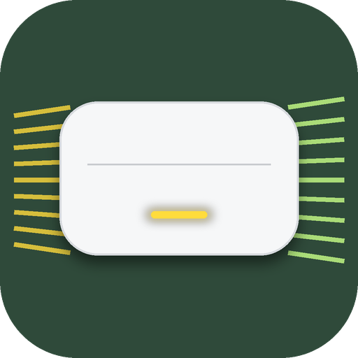

<p align="center">
  
</p>

# VMC Master: integrazione per il Marketplace di Home Assistant

Integrazione per **VMC Helty Flow Plus/Elite** che installa e aggiorna il package **VMC Master** dal Marketplace di Home Assistant (HACS integrato da Home Assistant 2026.11).

> **Versione beta (9.0.0b3).** La logica di funzionamento è quella della release manuale **8.6.0** del repository [VMC-HELTY-FLOW](https://github.com/DanRobo76/VMC-HELTY-FLOW), senza modifiche: l'integrazione genera gli stessi file che oggi creano a mano gli script Clona e Cambia IP, con due sole correzioni alla scheda (vedi sotto). Chi preferisce l'installazione manuale continua a usare la 8.6.0, che non cambia.

<sub>[English below](#english)</sub>

---

## Cosa fa

- **Una voce per ogni VMC**: si aggiunge da *Impostazioni → Dispositivi e servizi → Aggiungi integrazione → VMC Master* scrivendo nome e IP.
- **Installa il package** in `config/packages/vmc_helty_flow/‹nome›`: `vmc_‹nome›.yaml`, l'automazione principale (ora nel package, non va più incollata) e gli script Cambia IP e Cambia Nome.
- **Scheda «VMC Master» inclusa**: si aggiunge dalla plancia con *Aggiungi scheda → VMC Master* e si sceglie la VMC. È la stessa scheda della 8.6.0, con le stesse schede native di Home Assistant e le stesse immagini; si aggiorna insieme all'integrazione.
- **Aggiornamenti dal Marketplace**: a ogni nuova versione i file del package vengono riscritti e Home Assistant chiede il riavvio con una riparazione (*Impostazioni → Riparazioni*). L'IP impostato resta quello.
- **Versione nel pannello Informazioni**: «Package Ver.» mostra la versione dell'integrazione e l'avviso di aggiornamento della scheda legge le release di questo repository. Durante le beta (versioni con la «b», per esempio 9.0.0b2) l'avviso della scheda resta su «Nessun aggiornamento»: l'aggiornamento lo segnala il Marketplace.

### Differenze rispetto all'installazione manuale 8.6.0

| Funzione | Manuale 8.6.0 | Integrazione |
|---|---|---|
| Aggiungere una VMC | Finestra Clona + incollare automazione e scheda | *Aggiungi voce* (nome + IP), nient'altro da incollare |
| Cancellare una VMC | Finestra Clona + cancellare a mano automazione e scheda | Eliminare la voce: la cartella va in `config/vmc_master_backup` |
| Cambiare IP | Campo «Cambia IP VMC» della scheda | Lo stesso campo, oppure *Configura* sulla voce |
| Cambiare nome della VMC | Campo «Cambia Nome VMC» | Invariato |
| Prima Installazione VMC | Nella scheda Master | Invariata, nella scheda Master |
| Automazione principale | Incollata nell'editor (modificabile) | Nel package (`vmc_‹nome›_automazione.yaml`, sola lettura) |
| Nomi delle entità | `vmc_master_…`, `vmc_‹nome›_…` | Identici: la cronologia resta |

La Finestra Clona non c'è più: nella scheda e nel package viene tolto solo il blocco fra i segnaposto «SEZIONE CLONA VMC», lo stesso che la 8.6.0 toglie già alle VMC clonate.

Correzioni rispetto allo script Clona della 8.6.0, solo nella scheda:
- la riga `or is_state('input_boolean.vmc_master_opzione_finestra_clona', 'on')` viene tolta intera. Lo script Clona lasciava `or is_state('on')`, che faceva andare in errore il riquadro grande del Pannello Informazioni;
- il link del video resta `VMC_MASTER_promo_IT.mp4`. Nelle VMC clonate lo script Clona lo rinominava in `VMC_‹nome›_promo_IT.mp4`, un file che non esiste.

---

## Requisiti

- Home Assistant **2026.11** o successivo (Marketplace integrato). La versione si legge in *Impostazioni → Informazioni*.
- IP statico della VMC impostato nel router; la VMC risponde sulla porta **5001**.
- Package abilitati nel file `configuration.yaml` (come per la 8.6.0). Se manca la riga, l'integrazione lo segnala in *Impostazioni → Riparazioni*.

Ci sono due guide: **A** per chi non ha mai installato VMC Master, **B** per chi usa oggi la 8.6.0 manuale (anche con più VMC). I passi delle due guide sono gli stessi dove coincidono.

---

## Guida A: prima installazione

### A1. Abilitare i package
Serve l'app **File editor**: *Impostazioni → Applicazioni → Installa app → File editor → Installa*, poi **Avvia** e **Apri l'interfaccia web**.

1. In File editor premere l'icona della **cartella** in alto a sinistra e aprire `configuration.yaml`.
2. Aggiungere in fondo al file:

```yaml
homeassistant:
  packages: !include_dir_named packages/
```

   Se nel file c'è già una riga `homeassistant:`, non scriverla una seconda volta: aggiungere solo la riga `  packages: !include_dir_named packages/` subito sotto, con due spazi davanti.
3. Salvare con l'icona del **dischetto** in alto a destra.

### A2. Installare l'integrazione dal Marketplace
Finché l'integrazione non è nel catalogo pubblico, si aggiunge come repository personalizzato:

1. **Impostazioni → Marketplace**, menu **⋮** in alto a destra → **Repository personalizzati**;
2. nel campo del repository scrivere `https://github.com/DanRobo76/VMC-HELTY-FLOW-MARKETPLACE`, come tipo scegliere **Integrazione** e premere **Aggiungi**, poi chiudere la finestra;
3. cercare **VMC Master** nel Marketplace e aprirla: compare «Non installata» con il pulsante **Installa** a destra; premerlo e, se compare una finestra di conferma, premere di nuovo **Installa**.

### A3. Riavviare Home Assistant
*Impostazioni → Strumenti → YAML → Riavvia → Riavvia Home Assistant*. Attendere che l'interfaccia torni disponibile.

### A4. Aggiungere la VMC
1. *Impostazioni → Dispositivi e servizi*, pulsante **+ Aggiungi integrazione** in basso a destra;
2. scrivere **VMC Master** e cliccarla;
3. nella finestra **«Aggiungi una VMC Helty Flow»**:
   - **Nome VMC**: la prima si chiama `master` (è già scritto); le altre con un nome a scelta: sole lettere minuscole, da 1 a 10 caratteri, senza spazi né numeri;
   - **IP VMC su porta 5001**: l'IP statico della VMC, per esempio `192.168.1.160`;
   - premere **Invia**;
4. se compare **«VMC non raggiungibile»** (VMC spenta o non ancora collegata al Wi-Fi) premere **Invia** per aggiungerla comunque: l'IP si cambia più tardi con l'**icona ingranaggio** sulla riga della VMC;
5. nella finestra finale premere **Fine**.

Dopo la prima VMC, la pagina *Impostazioni → Dispositivi e servizi → VMC Master* mostra una riga per ogni VMC e il pulsante **Aggiungi dispositivo** in alto a destra: per le VMC successive si può usare anche quello.

### A5. Riavviare Home Assistant
In *Impostazioni*, in cima alla pagina, compare **«VMC Master: riavviare Home Assistant»**: cliccarla e premere **Invia**. Home Assistant si riavvia da solo. In alternativa: *Impostazioni → Strumenti → YAML → Riavvia → Riavvia Home Assistant*.

### A6. Aggiungere la scheda
1. Premere **Ctrl+F5** sulla pagina di Home Assistant, così il browser carica la scheda nuova;
2. aprire la plancia. Nelle installazioni nuove la plancia **Panoramica** è generata in automatico: in questo caso creare prima una plancia da *Impostazioni → Plance → Aggiungi plancia → Nuova plancia da zero*;
3. **icona matita** (Modifica la plancia) in alto a destra → **Aggiungi scheda**;
4. cercare **VMC Master** e cliccarla. C'è una sola scheda per tutte le VMC: la VMC si sceglie nel passo seguente;
5. nel campo **VMC** scegliere la VMC (per esempio «VMC master») e premere **Salva**, poi **Fatto** in alto a destra.

### A7. Profilo Inizializzazione
Come nella 8.6.0, solo la prima volta: nel pannello **Impostazioni** della scheda premere **Esegui** su **«VMC ‹nome› - Profilo Inizializzazione»** e confermare con **OK** nel popup «Vuoi Procedere?». Al riavvio aprire la finestra **«Opzioni - Sensori da Selezionare»** e scegliere le entità dei sensori.

Se la VMC non è ancora collegata al Wi-Fi di casa, si collega dalla **Finestra Prima Installazione VMC** della scheda Master, come descritto nel [README della 8.6.0](https://github.com/DanRobo76/VMC-HELTY-FLOW#readme).

### Altre VMC
Ripetere i punti **A4**, **A5**, **A6** e **A7** con un nome diverso. Si possono aggiungere più VMC di seguito e riavviare una volta sola.

---

## Guida B: passare dalla 8.6.0 manuale all'integrazione

La guida vale per la VMC `master` e per tutte le VMC create con la Finestra Clona, qualunque nome abbiano. Le VMC clonate **non vanno cancellate prima**, né con la Finestra Clona né a mano: le sposta l'integrazione.

### B1. Prima di iniziare
1. Creare un backup completo: *Impostazioni → Sistema → Backup*, pulsante in basso a destra, e attendere che il backup compaia nell'elenco.
2. Controllare la versione di Home Assistant: *Impostazioni → Informazioni* deve indicare **2026.11** o successiva.
3. Annotare nome e IP di ogni VMC. I nomi sono quelli delle cartelle in `config/packages/vmc_helty_flow`: `master` e una cartella per ogni VMC clonata; l'IP è quello statico impostato nel router. Per ogni VMC con la cartella presente l'integrazione mostra anche l'IP trovato, quindi si può controllare.

I package sono già abilitati dalla 8.6.0: il punto **A1** non serve.

### B2. Installare l'integrazione e riavviare
Eseguire i punti **A2** e **A3**.

### B3. Aggiungere la VMC master
1. Come al punto **A4**: *Impostazioni → Dispositivi e servizi → + Aggiungi integrazione → VMC Master*;
2. **Nome VMC** `master` e **IP** sono già scritti: controllarli e premere **Invia**;
3. compare **«Installazione manuale trovata»** con *IP scritto* e *IP nell'installazione manuale*: se sono uguali premere **Invia**; se sono diversi chiudere la finestra e ripetere con l'IP giusto;
4. nella finestra finale premere **Fine**.

La cartella manuale viene spostata in `config/vmc_master_backup/master_‹data›` e sostituita da quella dell'integrazione. I nomi delle entità restano uguali, quindi la cronologia e le impostazioni si conservano. **Non riavviare ancora**, anche se compare la richiesta di riavvio.

### B4. Aggiungere le VMC clonate
Ripetere il punto **B3** per ogni VMC clonata, scrivendo a mano il suo nome (lo stesso della sua cartella) e il suo IP. Si può partire anche dal pulsante **Aggiungi dispositivo** nella pagina *Impostazioni → Dispositivi e servizi → VMC Master*. Se la cartella di una VMC clonata non c'è più, la finestra «Installazione manuale trovata» non compare e l'integrazione la installa da zero: va bene così.

### B5. Eliminare le automazioni incollate a mano, prima del riavvio
Le automazioni principali ora sono nel package. Se restano anche quelle incollate, dopo il riavvio girano due automazioni uguali.

1. *Impostazioni → Automazioni e scenari*;
2. cliccare **«Automazione VMC Master»**, poi i **tre puntini** in alto a destra → **Elimina** e confermare;
3. ripetere per ogni VMC clonata: la sua automazione si chiama **«Automazione VMC ‹nome›»**, con il nome in minuscolo come lo ha scritto la Finestra Clona.

Eliminare solo le automazioni che si chiamano «Automazione VMC ‹nome›». Le altre automazioni «VMC Master - …» e «VMC ‹nome› - …» fanno parte del package e restano.

### B6. Riavviare Home Assistant
Come al punto **A5**: in *Impostazioni* cliccare **«VMC Master: riavviare Home Assistant»** e premere **Invia**. Home Assistant si riavvia da solo: non serve riavviarlo di nuovo.

### B7. Sostituire le schede
Conviene aggiungere prima la scheda nuova e togliere la vecchia solo dopo aver visto che funziona.

1. Premere **Ctrl+F5** sulla pagina di Home Assistant, così il browser carica la scheda nuova;
2. aprire la plancia con le vecchie schede → **icona matita** in alto a destra;
3. **Aggiungi scheda** → **VMC Master** (una sola scheda per tutte le VMC) → nel campo **VMC** scegliere la VMC → **Salva**;
4. controllata la scheda nuova, sulla vecchia scheda della stessa VMC: **tre puntini** → **Elimina**;
5. ripetere i passi 3 e 4 per ogni VMC, poi **Fatto** in alto a destra.

### B8. Controllo finale
- Nel **Pannello Informazioni** della scheda, «Package Ver.» indica la versione dell'integrazione (per esempio `v.9.0.0b3`).
- Il Profilo Inizializzazione **non va rifatto**: le impostazioni restano quelle di prima.
- Le automazioni principali «Automazione VMC ‹nome›» del package conservano area, etichette e categoria di quelle incollate.
- Le 18 entità della Finestra Clona della VMC master, che non esiste più, vengono tolte da sole al riavvio.
- Le cartelle in `config/packages/vmc_helty_flow` (una per VMC) sono quelle dell'integrazione: **non vanno cancellate**.
- La cartella `config/vmc_master_backup` contiene le vecchie installazioni manuali: conviene tenerla qualche giorno, perché serve per tornare alla 8.6.0, e cancellarla quando tutto funziona.

---

## Dopo l'installazione

- **Aggiungere un'altra VMC**: punti **A4**, **A5**, **A6** e **A7**.
- **Eliminare una VMC**: *Impostazioni → Dispositivi e servizi → VMC Master*, sulla riga della VMC **tre puntini → Elimina**. La cartella va in `config/vmc_master_backup`; poi riavviare e togliere la sua scheda.
- **Cambiare IP**: campo «Cambia IP VMC» della scheda, come nella 8.6.0, oppure l'**icona ingranaggio** sulla riga della VMC.
- **Aggiornare**: quando il Marketplace segnala una nuova versione premere **Aggiorna**, poi riavviare dalla riparazione «VMC Master: riavviare Home Assistant».

## Tornare alla 8.6.0 manuale

Il ritorno non è automatico. Ci sono due strade:

1. **Ripristinare il backup** fatto al punto **B1** (*Impostazioni → Sistema → Backup*, scegliere il backup e ripristinarlo). Torna tutto com'era, ma si perde ciò che è cambiato dopo il backup, per esempio la cronologia.
2. **A mano**, senza perdere la cronologia:
   - in *Impostazioni → Dispositivi e servizi → VMC Master*, su ogni VMC **tre puntini → Elimina**: l'integrazione sposta le sue cartelle in `config/vmc_master_backup`;
   - riportare le vecchie cartelle manuali da `config/vmc_master_backup` a `config/packages/vmc_helty_flow`, rinominandole con il solo nome della VMC (per esempio da `master_‹data›` a `master`);
   - incollare di nuovo le automazioni e le schede manuali della 8.6.0, poi riavviare.

---

## Licenza

**GNU General Public License v3.0** (file [LICENSE](LICENSE)). Copyright © 2023-2026 Ing. Danilo Robotti.

È consentito usare, copiare, modificare e distribuire il software, anche per scopi commerciali; chi lo distribuisce, anche modificato, deve renderne disponibile il codice sorgente con la stessa licenza e mantenere la nota di copyright. Il software è fornito senza alcuna garanzia.

La release manuale 8.6.0 del repository [VMC-HELTY-FLOW](https://github.com/DanRobo76/VMC-HELTY-FLOW) resta sotto PolyForm Noncommercial License 1.0.0.

**Impiego dell'Intelligenza Artificiale:** nello sviluppo del software l'autore si è avvalso anche di strumenti di intelligenza artificiale.

---

<a id="english"></a>
## English

Integration for **Helty Flow Plus/Elite** ventilation units that installs and updates the **VMC Master** package from the Home Assistant Marketplace (HACS built in since Home Assistant 2026.11).

- The logic is the unchanged manual release **8.6.0** of [VMC-HELTY-FLOW](https://github.com/DanRobo76/VMC-HELTY-FLOW): the integration writes the same files the Clone and Change IP scripts create by hand.
- **One entry per unit** (name + IP). The package goes to `config/packages/vmc_helty_flow/‹name›`, including the main automation (no more pasting).
- **«VMC Master» card included**: *Add card → VMC Master*, then pick the unit. Same card as 8.6.0, updated with the integration.
- Requirements: Home Assistant 2026.11+, `packages: !include_dir_named packages/` under `homeassistant:` in `configuration.yaml`, static IP for the unit (port 5001).

**A. First installation**
1. Enable packages in `configuration.yaml` (File editor app).
2. *Settings → Marketplace → ⋮ → Custom repositories*, URL `https://github.com/DanRobo76/VMC-HELTY-FLOW-MARKETPLACE`, type **Integration**; search **VMC Master** and press **Install**.
3. Restart Home Assistant.
4. *Settings → Devices & services → + Add integration → VMC Master*: name (`master` for the first unit) and IP, then **Submit**.
5. Restart from the repair «VMC Master: riavviare Home Assistant».
6. Dashboard: pencil → **Add card → VMC Master**, pick the unit, **Save**.
7. Run «VMC ‹name› - Profilo Inizializzazione» once and pick the sensors.

**B. Moving from manual 8.6.0** (the `master` unit and every unit created with the Clone window, whatever its name; do not delete cloned units first)
1. Make a full backup; check Home Assistant is 2026.11+.
2. Steps A2 and A3.
3. Add each unit with the same name and its IP; confirm «Installazione manuale trovata» if both IPs match. The manual folder is moved to `config/vmc_master_backup`; entity names, history and settings stay. Do not restart yet.
4. **Before restarting**, delete the hand-pasted automations «Automazione VMC Master» and «Automazione VMC ‹name›» of each cloned unit, with the name in lowercase (otherwise two identical automations run). The «VMC ‹name› - …» automations belong to the package and stay.
5. Restart from the repair, then replace each old card with a **VMC Master** card. No Profilo Inizializzazione needed; the 18 Clone-window entities of `master` are removed automatically.
6. Going back to manual 8.6.0 is not automatic: restore the backup, or delete the units from the integration, move the old folders back from `config/vmc_master_backup` and paste the automations and cards again.

Licence: **GPL-3.0**. Copyright © 2023-2026 Ing. Danilo Robotti.
